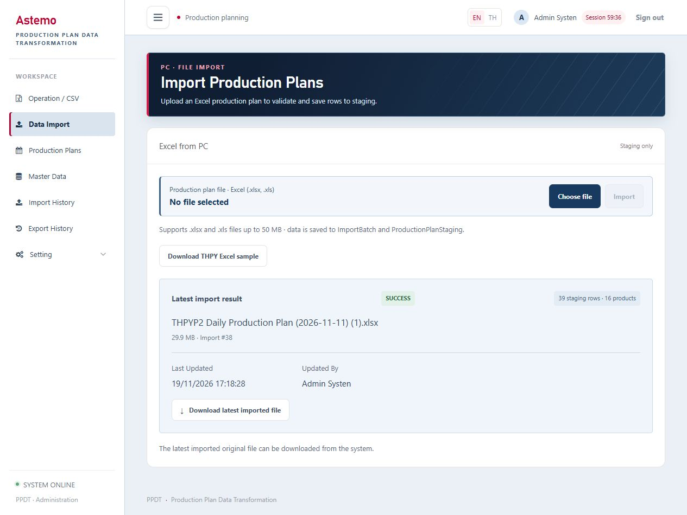
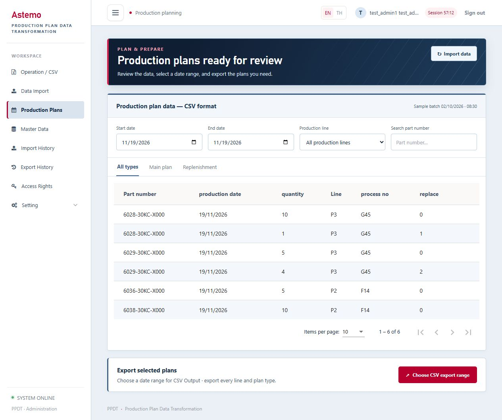
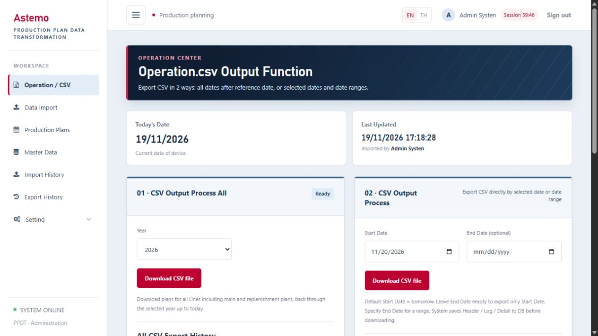
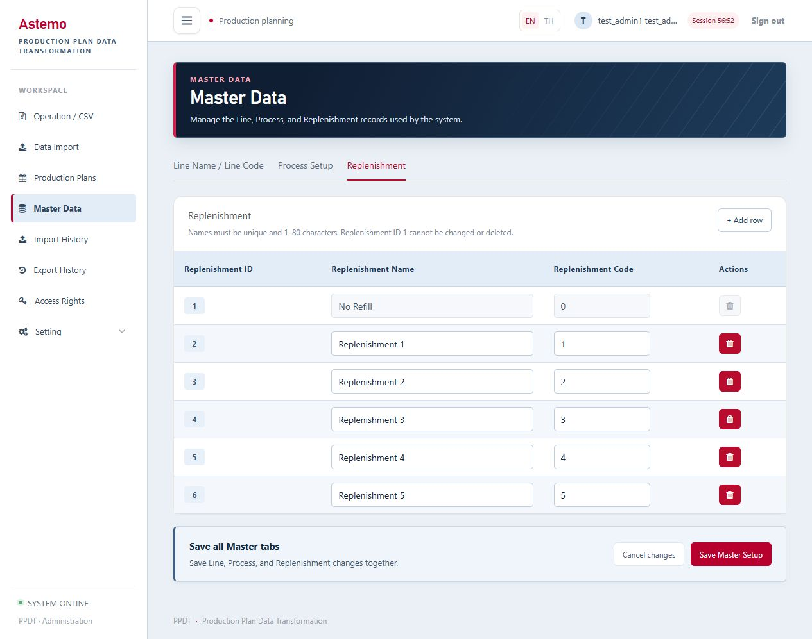
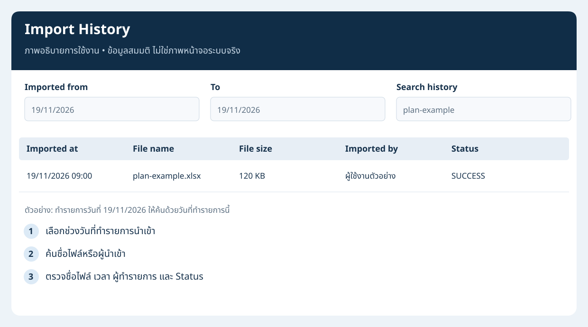
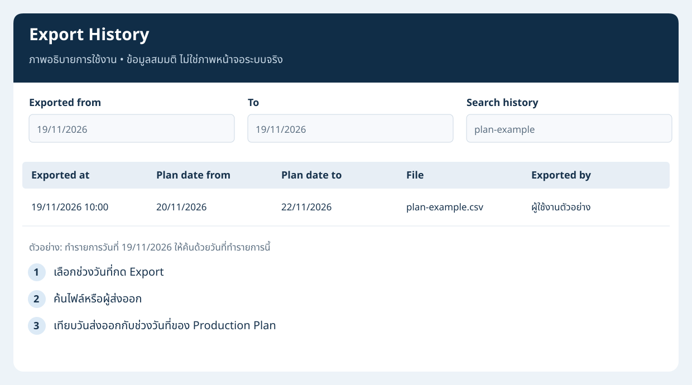
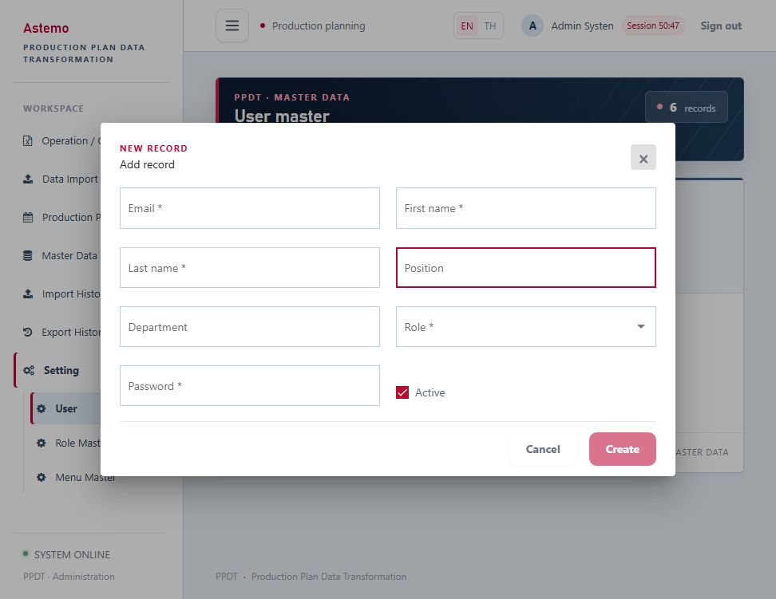
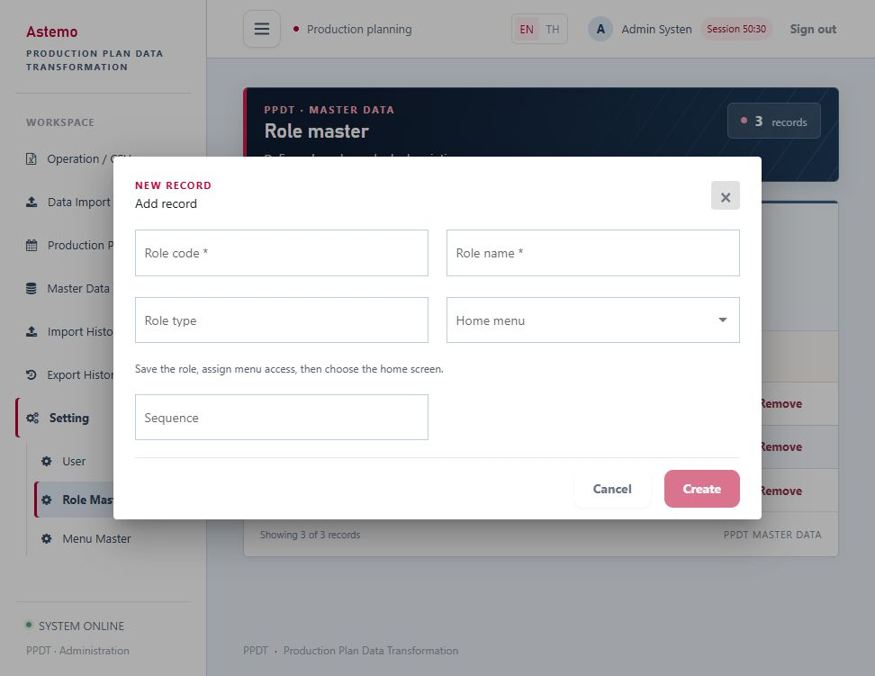

# คู่มือใช้งาน PPDT แบบละเอียด

Production Plan Data Transformation · ภาษาไทย · ปรับปรุงจากหน้าจอวันที่ 19 พฤศจิกายน 2026

## เริ่มที่นี่ — เลือกงานที่ต้องการทำ

**PPDT คือพื้นที่ทำงานสำหรับนำเข้าแผนผลิต ตรวจสอบแผน และส่งออก CSV** คู่มือนี้เริ่มตั้งแต่หน้า Login ไปจนถึงการตั้งค่าผู้ใช้ โดยเรียงขั้นตอนให้ทำตามได้ทีละงาน

### ดูลำดับงานแบบ Flow

ใช้ลิงก์ **Flow ระบบ: ดูลำดับงาน** ด้านซ้าย เพื่อดูภาพรวมและเลือกงาน เช่น นำเข้า Excel ตรวจแผน หรือส่งออก CSV คลิกกล่องในผังเพื่อดูวิธีทำ จุดตรวจ และทางเลือกเมื่อยังไม่ผ่าน

### กลุ่มหัวข้อในสารบัญ

- **Production Control:** Data Import, Production Plans, Master Data และ Import History
- **Production:** Operation / CSV และ Export History

### ฉันควรเริ่มอ่านบทไหน

| งานของคุณ | เริ่มที่บท | ผลที่ต้องตรวจหลังทำ |
|---|---|---|
| ใช้ระบบครั้งแรก | 1. เข้าสู่ระบบและรู้จักหน้าจอ | ชื่อบัญชีถูกต้องและพบเมนูตามหน้าที่ |
| ต้องนำไฟล์ Excel เข้า | 2. นำเข้าแผนผลิต | ตรวจ Latest import result และประวัตินำเข้า |
| ต้องตรวจ Part / วัน / จำนวน | 3. ตรวจสอบแผนผลิต | ช่วงวันที่ Line และประเภทแผนตรงกับงาน |
| ต้องใช้ไฟล์ CSV | 4. ส่งออก CSV | เลือกช่วงถูกต้อง ตรวจไฟล์และประวัติ |
| ต้องเพิ่ม Line หรือ Process | 5. ตั้งค่าข้อมูลหลัก | ตรวจทุกแท็บก่อน Save Master Setup |
| อยากรู้ว่าใครนำเข้าหรือส่งออก | 6–7. ประวัติ | วันที่ทำรายการ ชื่อไฟล์ และผู้ดำเนินการตรงกัน |
| ต้องดูแลบัญชีและบทบาท | 8–9. User / Role Master | ข้อมูลและบทบาทของบัญชีตรงกับหน้าที่ |
| ติดปัญหาระหว่างทำงาน | 10. แก้ปัญหาทีละอาการ | ได้จุดตรวจและข้อมูลที่ใช้แจ้งผู้ดูแล |
| ต้องการตัวอย่างทำตามทั้งงาน | 11. ตัวอย่างงานตั้งแต่ต้นจนจบ | ตรวจครบตั้งแต่ไฟล์ต้นฉบับจนถึง CSV |

### ลำดับงานประจำวัน

1. **เข้าสู่ระบบ** และตรวจบัญชีที่มุมบน
2. **นำเข้าไฟล์** เมื่อได้รับแผน Excel ฉบับที่พร้อมใช้งาน
3. **ตรวจผลนำเข้า** ว่าเป็นไฟล์ที่ต้องการและมีสถานะสำเร็จ
4. **ตรวจแผนผลิต** โดยเลือกวันที่ Line และ Part ที่ต้องตรวจ
5. **เลือกวันส่งออก CSV** และตรวจว่าเลือกปุ่มในส่วนที่ถูกต้อง
6. **ตรวจไฟล์ที่ดาวน์โหลด** พร้อมประวัติ ก่อนส่งต่อเข้ากระบวนการที่องค์กรกำหนด

### ฉบับนี้อ้างอิงหน้าจอใด

เปิดตรวจหน้าระบบจริงด้วยบัญชีตัวอย่าง Administration ที่หน้า Login วันที่ 19 พฤศจิกายน 2026 พบเมนูหลัก Operation / CSV, Data Import, Production Plans, Master Data, Import History, Export History และ Setting โดยคู่มือนี้อธิบายการดูแล User และ Role Master

**ขอบเขตการตรวจ:** ตรวจหน้าจอและเปิดแบบฟอร์มโดยไม่บันทึก ยังไม่ได้ทดลองนำเข้า ส่งออก สร้างบัญชี หรือแก้ Master ในการทำคู่มือรอบนี้ ขั้นตอนหลังปุ่มบันทึกให้ตรวจผลจริงตามระบบ ส่วนที่ยังยืนยันไม่ได้ระบุไว้เฉพาะจุด

ภาพบางส่วนเป็นภาพอ้างอิงจากการสำรวจก่อนหน้า ใช้อ่านตำแหน่งช่องและปุ่ม ชื่อผู้ใช้ เวลา จำนวนรายการ และข้อมูลตัวอย่างในภาพไม่ใช่ค่าที่ต้องกรอกตาม

## 1. เข้าสู่ระบบและรู้จักหน้าจอ

### ก่อนเริ่ม

เตรียมบัญชี PPDT ที่ผู้ดูแลให้มา และเปิดระบบผ่านลิงก์ที่องค์กรใช้ หากไม่เคยได้รับบัญชี ให้ติดต่อผู้ดูแลก่อน ไม่ใช้ข้อมูลบัญชีของบุคคลอื่น

### เข้าสู่ระบบทีละขั้น

1. เปิด **https://ppdt.toptier-ari.com/login**
2. ตรวจว่าหน้าจอแสดงชื่อ **Production Plan Data Transformation** และช่อง Email / Password
3. ใส่อีเมลบัญชีของคุณใน **Email**
4. ใส่รหัสผ่านใน **Password** ระวังภาษาคีย์บอร์ด Caps Lock และช่องว่างที่ติดมาจากการคัดลอก
5. หากต้องตรวจตัวอักษรที่พิมพ์ ใช้ **Show password** เฉพาะเมื่อไม่มีผู้อื่นมองเห็นหน้าจอ แล้วซ่อนกลับ
6. กด **Sign in** เมื่อปุ่มพร้อมใช้งาน
7. เมื่อเข้าระบบแล้ว ตรวจชื่อบัญชีมุมบนและเมนูด้านซ้าย ก่อนเริ่มทำงาน

**สังเกตผล:** ต้องออกจากหน้า Welcome back ไปยังพื้นที่ทำงานของระบบ หน้าแรกอาจต่างกันตาม Role / Home menu ของบัญชี

หน้า Login ที่สำรวจมีปุ่มเลือกบัญชีทดลอง Admin / PC / PD ซึ่งกรอกข้อมูลตัวอย่างให้แล้วต้องกด Sign in ต่อ ปุ่มนี้ใช้เมื่อเจ้าของระบบอนุญาตให้ทดลองเท่านั้น ไม่ใส่รหัสผ่านบัญชีตัวอย่างลงในคู่มือนี้

### ส่วนประกอบหน้าจอที่ใช้บ่อย

| ส่วนหน้าจอ | ใช้ทำอะไร | วิธีใช้ |
|---|---|---|
| เมนูด้านซ้าย | เปลี่ยนหน้างาน | คลิกชื่อหน้า เช่น Data Import |
| ปุ่มย่อแถบเมนู | เพิ่มพื้นที่อ่านตาราง | กดไอคอนเมนูมุมซ้ายบน และเปิดกลับเมื่อต้องเปลี่ยนหน้า |
| EN / TH | เลือกภาษาที่แสดง | เลือกภาษาที่อ่านสะดวก ชื่อปุ่มในคู่มือนี้ยึดภาษาอังกฤษ |
| ชื่อบัญชี | ตรวจผู้ใช้งานปัจจุบัน | ตรวจทุกครั้งก่อนนำเข้าหรือบันทึกข้อมูล |
| Session | เวลาที่เหลือของการใช้งาน | หากกลับหน้า Login ให้เข้าสู่ระบบใหม่และตรวจผลรายการล่าสุดก่อนทำซ้ำ |
| Sign out | ออกจากระบบ | ใช้เมื่อทำงานเสร็จ โดยเฉพาะเครื่องที่ใช้ร่วมกัน |

### ถ้าเข้าสู่ระบบไม่ได้

1. ตรวจ Email ว่าตรงบัญชีที่ได้รับ ไม่ใช่อีเมลส่วนตัวที่ยังไม่ได้ลงทะเบียน
2. ตรวจภาษาคีย์บอร์ดและรหัสผ่านอีกครั้ง
3. หากปุ่ม Sign in ยังไม่พร้อม ให้ตรวจว่ากรอกครบทั้งสองช่อง
4. หากระบบยังปฏิเสธ ให้แจ้งผู้ดูแลพร้อมข้อความที่พบและเวลาที่เกิด โดยไม่ส่งรหัสผ่าน

### ออกจากระบบ

1. ทำรายการที่กำลังบันทึกให้เสร็จและตรวจผลก่อน
2. คลิก **Sign out** ที่มุมบน
3. ตรวจว่ากลับหน้าเข้าสู่ระบบแล้ว ก่อนส่งต่อเครื่องให้ผู้อื่น

## 2. Data Import — นำเข้าแผนผลิตจาก Excel

### หน้านี้ใช้ทำอะไร

นำไฟล์แผนผลิต Excel เข้าสู่พื้นที่ตรวจสอบข้อมูลของระบบ หน้าจอเรียกว่า **Staging only** หมายถึงต้องตรวจผลนำเข้าและข้อมูลแผนต่อ ไม่ควรถือว่าเลือกไฟล์แล้วข้อมูลพร้อมส่งออกทันที

### เตรียมไฟล์ก่อนกด Import

| สิ่งที่ตรวจ | เงื่อนไขที่หน้าจอระบุ | ตัวอย่างการตรวจ |
|---|---|---|
| ชนิดไฟล์ | .xlsx หรือ .xls | ตรวจนามสกุลจริง การเปลี่ยนชื่อ .txt เป็น .xlsx ไม่ได้แปลงชนิดไฟล์ |
| ขนาด | ไม่เกิน 50 MB | ดูขนาดจากรายละเอียดไฟล์ก่อนเลือก |
| รูปแบบข้อมูล | ใช้รูปแบบที่ระบบรองรับ | ดาวน์โหลด THPY Excel sample เพื่อเทียบโครงสร้าง |
| ฉบับของแผน | ต้องตรงงานที่ได้รับ | ตรวจวันของไฟล์และชื่อฉบับกับผู้จัดทำแผน |
| ความพร้อม | ตรวจ Part / วัน / จำนวนในไฟล์ | เปิด Excel ต้นฉบับตรวจข้อมูลก่อนนำเข้า |

### ขั้นตอนนำเข้า

1. เลือก **Data Import** ที่เมนูด้านซ้าย
2. หากยังไม่มีไฟล์ตัวอย่าง กด **Download THPY Excel sample** เพื่อใช้เป็นแนวทางเตรียมไฟล์
3. กด **Choose file** ในส่วน Excel from PC
4. เลือก Excel ที่เตรียมไว้จากเครื่อง
5. ตรวจชื่อไฟล์ที่แสดงแทนข้อความ No file selected ว่าถูกต้อง หากเลือกผิดให้เลือกใหม่ก่อนนำเข้า
6. กด **Import** เมื่อปุ่มพร้อมใช้งาน แล้วรอผล ไม่กดซ้ำระหว่างกำลังนำเข้า
7. อ่านผลในส่วน **Latest import result**
8. ตรวจชื่อไฟล์ สถานะ จำนวนข้อมูล เวลาปรับปรุง และผู้ปรับปรุง
9. เปิด **Import History** เพื่อตรวจประวัติของครั้งนั้น
10. เมื่อข้อมูลพร้อมตามกระบวนการของทีม จึงเปิด **Production Plans** เพื่อตรวจแผนที่ต้องใช้งาน

### อ่าน Latest import result ให้ถูกต้อง

| ข้อมูลที่แสดง | ความหมาย | สิ่งที่ต้องตรวจ |
|---|---|---|
| SUCCESS | ระบบรายงานนำเข้าสำเร็จ | ชื่อไฟล์และจำนวนข้อมูลต้องตรงชุดที่ตั้งใจนำเข้า |
| staging rows | จำนวนแถวที่เก็บในพื้นที่ตรวจสอบ | อย่าเท่ากับจำนวนสินค้าโดยอัตโนมัติ หนึ่งสินค้าอาจมีหลายแถว |
| products | จำนวนสินค้าที่ผลนำเข้าระบุ | เทียบกับไฟล์ต้นฉบับตามรูปแบบแผน |
| ชื่อไฟล์ / ขนาด | ไฟล์ของรายการล่าสุด | ต้องตรงกับไฟล์ที่เลือก |
| Import # | เลขอ้างอิงการนำเข้า | จดเลขนี้เมื่อแจ้งปัญหา |
| Last Updated / Updated By | เวลาและผู้ปรับปรุง | ตรวจว่าเป็นรายการที่เพิ่งทำ ไม่ใช่ผลก่อนหน้า |

### ดาวน์โหลดต้นฉบับที่นำเข้าล่าสุด

1. อยู่ที่หน้า Data Import
2. ตรวจว่ารายการ Latest import result เป็นชุดที่ต้องการ
3. กด **Download latest imported file**
4. ตรวจรายการดาวน์โหลดในเบราว์เซอร์และชื่อไฟล์ที่ได้

ปุ่มนี้หมายถึงไฟล์ล่าสุดที่ระบบแสดง ไม่ใช่ตัวเลือกดาวน์โหลดต้นฉบับทุกครั้งในอดีต

### ถ้านำเข้าไม่สำเร็จ

ตรวจชนิด/ขนาด/รูปแบบไฟล์ก่อน หากมีสถานะ FAILED ให้จดชื่อไฟล์ เวลา และ Import # ถ้ามี แล้วให้ผู้ดูแลตรวจสาเหตุ กรณีไฟล์เดิมนำเข้าซ้ำหรือไฟล์มีข้อมูลผิดบางแถว ต้องยืนยันนโยบายเพิ่ม/แทนที่/นำเข้าบางส่วนกับเจ้าของระบบก่อนทำซ้ำ

## 3. Production Plans — ตรวจสอบแผนก่อนส่งออก

### หน้านี้ใช้ทำอะไร

ดูแผนในรูปแบบตาราง โดยจำกัดวันผลิต Line หมายเลขสินค้า และประเภทแผน เพื่อช่วยตรวจข้อมูลก่อนเลือกช่วงส่งออก

### ความหมายตัวกรอง

| ช่อง | วิธีเลือก | ใช้เมื่อใด |
|---|---|---|
| Start date | เลือกวันเริ่มตรวจ | ต้องตรวจตั้งแต่วันใด |
| End date | เลือกวันสุดท้ายที่ต้องตรวจ | ถ้าตรวจวันเดียวให้เลือกวันเดียวกับ Start เพื่อให้อ่านชัด |
| Production line | เลือก Line หรือ All production lines | ตรวจเฉพาะสายการผลิตหรือทุกสาย |
| Search part number | กรอกหมายเลขสินค้าที่ต้องหา | ตรวจสินค้าเฉพาะรายการ |
| All types | ดูทุกประเภทแผน | ตรวจภาพรวม |
| Main plan | ดูแผนหลัก | ตรวจปริมาณแผนหลัก |
| Replenishment | ดูแผนเติม | ตรวจรายการเติมสินค้า |

### ขั้นตอนตรวจแผน

1. เลือก **Production Plans**
2. ตั้ง **Start date / End date** ให้ตรงช่วงที่ต้องตรวจ
3. เลือก **Production line** หรือ All production lines
4. หากต้องตรวจสินค้าเฉพาะตัว ให้กรอก **Search part number**
5. เลือกประเภทแผนให้ตรงกับสิ่งที่จะตรวจ
6. อ่าน Part number และ production date ก่อน แล้วจึงตรวจ quantity, Line, process no และ replace
7. หากมีหลายหน้า ใช้ **Items per page** และปุ่มเปลี่ยนหน้าเพื่อดูให้ครบ
8. หากต้องเรียงรายการ คลิกหัวคอลัมน์ที่เป็นปุ่ม แล้วตรวจทิศทางลำดับที่ได้
9. หากต้องส่งออกช่วงวันที่นี้ กด **Choose CSV export range** ด้านล่าง
10. ตรวจ Start Date / End Date อีกครั้งที่หน้า Operation / CSV ก่อนดาวน์โหลด

### อ่านหนึ่งแถวอย่างไร

| คอลัมน์ | ความหมายในการตรวจ | ตัวอย่างสมมติ |
|---|---|---|
| Part number | หมายเลขสินค้า | PART-DEMO-A |
| production date | วันผลิตของแถวนั้น | 20/11/2026 |
| quantity | ปริมาณของรายการ | 10 |
| Line | รหัสสายการผลิต | P2 |
| process no | รหัสกระบวนการ | รหัสที่ทีมตั้งใน Master |
| replace | รหัสที่แสดงในแผน/ข้อมูลส่งออก | ต้องให้ทีมยืนยันความหมายและความสัมพันธ์กับ Replenishment |

### ตัวอย่างตรวจวันเดียว

สมมติต้องตรวจแผนวันที่ **20/11/2026** ให้ตั้ง Start และ End เป็นวันนี้ เลือก Line ที่รับผิดชอบ แล้วค้น Part ที่ต้องการตรวจ หากไม่พบ ให้ล้าง Part และเลือก All production lines / All types เพื่อแยกว่าไม่มีแผนจริงหรือถูกตัวกรองซ่อนไว้

**ก่อนส่งออกควรรู้:** คำอธิบายส่วนส่งออกระบุว่าครอบคลุม **ทุก Line และทุกประเภทแผน** ตัวกรอง Line, Part และ Plan type ใช้ตรวจตาราง ไม่ควรถือว่าจะจำกัดข้อมูลในไฟล์ CSV ด้วย

หน้าที่สำรวจยังมีคำว่า Sample batch กำกับอยู่ ให้ยืนยันชุดข้อมูลที่ตารางอ้างอิงกับผู้ดูแลหากจำนวนไม่ตรงกับไฟล์นำเข้าล่าสุด

## 4. Operation / CSV — ส่งออกไฟล์อย่างถูกช่วงวันที่

### หน้านี้ใช้ทำอะไร

หน้านี้แบ่งงานเป็นสองส่วนที่มีวัตถุประสงค์ต่างกัน แม้ปุ่มดาวน์โหลดจะชื่อเหมือนกัน:

- **ส่วนที่ 1 — ดูข้อมูลย้อนหลังที่เคย Export แล้ว:** ใช้ตรวจสอบหรือดาวน์โหลดข้อมูลที่มีการ Export ไปแล้ว โดยช่วงข้อมูลย้อนหลังต้องไม่เกินวันที่ปัจจุบัน **(วันที่ ≤ วันนี้)**
- **ส่วนที่ 2 — Export Production Plan สำหรับนำเข้า Line การผลิต:** ใช้เตรียมไฟล์แผนผลิตตามวันหรือช่วงวันที่ต้องนำไปใช้งานใน Line การผลิต

หากต้องการแผนสำหรับนำเข้า Line ให้เลือก **ส่วนที่ 2** หากต้องการตรวจข้อมูลเก่าที่เคย Export ไปแล้ว ให้เลือก **ส่วนที่ 1**

### เลือกวิธีส่งออกก่อน

| ต้องการข้อมูลแบบใด | ใช้ส่วนใด | สิ่งที่ต้องกรอก |
|---|---|---|
| ดู/ดาวน์โหลดข้อมูลย้อนหลังที่เคย Export แล้ว โดยวันที่ ≤ วันที่ปัจจุบัน | ส่วนที่ 1 · CSV Output Process All | Year เพื่อเลือกข้อมูลย้อนหลัง |
| Production Plan วันเดียว สำหรับนำเข้า Line การผลิต | ส่วนที่ 2 · CSV Output Process | Start Date และเว้น End Date ว่าง |
| Production Plan หลายวันต่อเนื่อง สำหรับนำเข้า Line การผลิต | ส่วนที่ 2 · CSV Output Process | Start Date และ End Date |

### ตรวจข้อมูลด้านบนก่อนดาวน์โหลด

- **Today's Date:** หน้าจอระบุว่าใช้วันที่จากอุปกรณ์ ตรวจวันของเครื่องหากค่าเริ่มต้นดูผิด
- **Last Updated:** เวลาที่ระบบแสดงว่าข้อมูลได้รับการปรับปรุง
- **Imported by:** ผู้ที่นำเข้าข้อมูลของรายการที่แสดง

สำหรับส่วนที่ 2 หาก Last Updated หรือไฟล์นำเข้ายังไม่ตรงฉบับที่ต้องใช้ ให้ตรวจ Data Import / Import History และแผนที่พร้อมนำเข้า Line ก่อนส่งออก ส่วนที่ 1 ให้ตรวจข้อมูลย้อนหลังที่เคย Export แล้วและขอบเขตไม่เกินวันนี้

### เงื่อนไขค่าเริ่มต้น Start Date หลังเคย Export แล้ว

สำหรับ **ส่วนที่ 2 · CSV Output Process** เมื่อมีข้อมูลที่ Export ไปแล้ว ระบบต้องกำหนดค่าเริ่มต้นของช่อง **Start Date เป็นวันถัดจากวันที่ของข้อมูลที่ Export ไปแล้วโดยอัตโนมัติ** เพื่อให้การส่งออกครั้งถัดไปเริ่มต่อจากข้อมูลเดิม

| ตัวอย่าง | ค่าเริ่มต้นที่ระบบต้องแสดง |
|---|---|
| Export ข้อมูลวันที่ 20/11/2026 ไปแล้ว | Start Date = 21/11/2026 |
| Export ข้อมูลวันที่ 30/11/2026 ไปแล้ว | Start Date = 01/12/2026 |
| Export ข้อมูลวันที่ 31/12/2026 ไปแล้ว | Start Date = 01/01/2027 |

1. หลัง Export ให้ตรวจวันที่ของข้อมูลที่ส่งออกและประวัติรายการนั้น
2. เมื่อเตรียมส่งออกครั้งถัดไป ให้ตรวจว่า Start Date ตั้งต้นเป็นวันถัดไปให้อัตโนมัติ
3. ตรวจ Start Date และ End Date ให้ตรงกับ Production Plan ที่ต้องนำเข้า Line ก่อนกด Download CSV file ทุกครั้ง
4. หากค่าเริ่มต้นไม่เลื่อนไปวันถัดไป ให้จดวันที่ของข้อมูลที่ Export ล่าสุด ค่า Start Date ที่พบ และเวลาทำรายการเพื่อแจ้งผู้ดูแล

**ขอบเขตของเงื่อนไข:** ใช้กับ CSV Output Process ของส่วนที่ 2 ส่วนที่ 1 ยังคงใช้ดูข้อมูลย้อนหลังที่เคย Export แล้วจนถึงวันที่ปัจจุบัน เงื่อนไขนี้ระบุพฤติกรรมที่ระบบต้องทำตามข้อกำหนดที่ผู้ใช้ให้มา ยังไม่ได้ยืนยันผลทดสอบระบบจริง และไม่ได้ระบุการเปลี่ยนค่า End Date อัตโนมัติ

### ส่วนที่ 2: Export Production Plan วันเดียวเพื่อนำเข้า Line

1. เปิด **Operation / CSV**
2. ไปที่ส่วน **02 · CSV Output Process**
3. เลือก **Start Date** เป็นวันที่ต้องการ เช่น 20/11/2026
4. ตรวจว่า **End Date (optional)** ว่างจริง หากมีค่าวันจากงานก่อนหน้าให้ล้างก่อน
5. อ่านข้อความใต้ปุ่ม หากมีข้อความแจ้งเงื่อนไขหรือปุ่มไม่พร้อมให้แก้ตามข้อความก่อน
6. กด **Download CSV file ของส่วน 02**
7. ตรวจรายการดาวน์โหลดของเบราว์เซอร์และเปิดไฟล์จากตำแหน่งที่บันทึก
8. ตรวจข้อมูลในไฟล์ว่าเป็นวันและชุดแผนที่ต้องการ
9. ตรวจประวัติในหน้าจอและ Export History ให้สัมพันธ์กับเวลาที่สั่ง

### ส่วนที่ 2: Export Production Plan ช่วงวันที่เพื่อนำเข้า Line

1. ไปที่ส่วน **02 · CSV Output Process**
2. เลือก Start Date เช่น **20/11/2026**
3. เลือก End Date เช่น **22/11/2026**
4. ตรวจลำดับวันให้ End ไม่อยู่ก่อน Start และตรวจปีให้ถูกต้อง
5. ตรวจข้อมูลแผนในช่วงนั้นจาก Production Plans หากยังไม่ได้ตรวจ
6. กด Download CSV file ในส่วน 02 เมื่อปุ่มพร้อม
7. ตรวจวันเริ่ม/วันสิ้นสุดในไฟล์และประวัติ ไม่ใช้ชื่อไฟล์เพียงอย่างเดียวตัดสินว่าข้อมูลครบ

ตัวอย่างวันที่ในบทนี้เป็นสถานการณ์สมมติ ต้องเปลี่ยนเป็นวันที่ของงานจริง และไม่รับประกันว่าระบบมีแผนในวันตัวอย่าง

### ส่วนที่ 1: ดูข้อมูลย้อนหลังที่เคย Export แล้ว

1. ไปที่ส่วน **01 · CSV Output Process All**
2. เลือก **Year** ของข้อมูลย้อนหลังที่ต้องการ
3. ตรวจว่าข้อมูลนั้นเป็นรายการที่เคย Export ไปแล้ว และช่วงข้อมูลสิ้นสุดไม่เกินวันที่ปัจจุบัน **(วันที่ ≤ วันนี้)**
4. ใช้ **Download CSV file ของส่วนที่ 1** เมื่อต้องการไฟล์ย้อนหลังสำหรับตรวจสอบ
5. ตรวจข้อมูลที่ได้กับประวัติการ Export และตาราง **All CSV Export History** ที่เกี่ยวข้อง

**ตัวอย่าง:** ถ้าวันปัจจุบันคือ 19/11/2026 ส่วนที่ 1 ใช้ตรวจข้อมูลย้อนหลังที่เคย Export แล้วถึงวันที่ 19/11/2026 ส่วนการเตรียม Production Plan วันที่ 20/11/2026 เพื่อนำเข้า Line ให้ใช้ส่วนที่ 2

**แยกวัตถุประสงค์ให้ชัด:** ส่วนที่ 1 ใช้อ้างอิงข้อมูลที่เคย Export แล้ว ส่วนที่ 2 ใช้เตรียมไฟล์ Production Plan เพื่อนำเข้า Line การผลิต เลือกตามงาน ไม่เลือกจากชื่อปุ่ม Download เพียงอย่างเดียว

### ประวัติสองส่วนในหน้า Operation

| ตาราง | ใช้ตรวจอะไร | คอลัมน์สำคัญ |
|---|---|---|
| All CSV Export History | รายการอ้างอิงของส่วนที่ 1 สำหรับตรวจข้อมูลย้อนหลังที่เคย Export แล้ว | Exported At, Year, File / User, Records in file |
| Export History by Plan Date | การ Export Production Plan ของส่วนที่ 2 ตามวันที่แผนที่เลือก | Exported At, File / User, Records in file |

จำนวน Records in file คือจำนวนรายการที่ระบบแสดงของไฟล์นั้น ไม่ควรสับสนกับจำนวนสินค้าที่ไม่ซ้ำในผลนำเข้า

### หลังดาวน์โหลดต้องตรวจอะไร

1. มีไฟล์ในเครื่องจริง ไม่ใช่มีประวัติคำขออย่างเดียว
2. ชื่อไฟล์และเวลาของการส่งออกสัมพันธ์กับงานที่เพิ่งทำ
3. วันผลิต Part จำนวน Line และรหัสกระบวนการตรงกับข้อมูลที่ทีมตรวจ
4. อ่านภาษาและคอลัมน์ได้ถูกต้องตามโปรแกรมที่ปลายทางใช้
5. ถ้าระบบบันทึกประวัติแล้วแต่ไม่พบไฟล์ ให้ตรวจรายการดาวน์โหลดก่อนกดซ้ำ เพราะหน้าจอระบุว่าบันทึกข้อมูลก่อนดาวน์โหลด

## 5. Master Data — ตั้งค่า Line, Process และ Replenishment

### หน้านี้ใช้ทำอะไร

ดูแลข้อมูลหลักที่ใช้ตีความแผนผลิต แบ่งเป็น 3 แท็บ และปุ่ม **Save Master Setup บันทึกการแก้ไขของทุกแท็บพร้อมกัน** จึงต้องตรวจทั้งหมดก่อนบันทึก

### เตรียมก่อนแก้ไข

1. ตรวจว่าเป็นข้อมูลที่ทีมตกลงให้แก้ และทราบค่าที่ต้องเปลี่ยน
2. จดหรือเก็บข้อมูลเดิมของรายการที่จะเปลี่ยน เพื่อใช้ตรวจเทียบ
3. ทราบว่า Line / Process / Replenishment ที่แก้มีผลต่อแผนใดบ้าง
4. หากไม่แน่ใจว่ารายการถูกใช้อยู่หรือไม่ ให้ผู้ดูแลตรวจ ก่อนกด Remove

### แท็บ Line Name / Line Code

| ช่อง | ความหมาย | กติกาที่เห็นบนหน้าจอ |
|---|---|---|
| Line Name | ชื่อสายการผลิตที่ผู้ใช้เรียก | ระบุให้ตรงข้อมูลที่ทีมตกลง |
| Line Code | รหัสที่ใช้ในข้อมูลแผน | ต้องระบุและไม่ซ้ำกัน |

1. เปิด **Master Data → Line Name / Line Code**
2. หากเพิ่มใหม่ กด **+ Add row**
3. ระบุ Line Name และ Line Code ที่ได้รับมา
4. หากแก้ของเดิม ให้ตรวจแถวจากรหัสก่อนแก้ ไม่ยึดเพียงตำแหน่งแถว
5. ตรวจ Line Code ว่าไม่ว่างและไม่ซ้ำรายการอื่น
6. ตรวจแท็บอื่นที่อาจมีการแก้ค้าง ก่อนบันทึกทั้งชุด

### แท็บ Process Setup

| ช่อง | ความหมาย | วิธีตรวจ |
|---|---|---|
| Filter Line Name | เลือก Line ที่จะดู/เพิ่ม Process | เลือกให้ถูกก่อน Add row |
| Line Name ในแถว | Line ของ Process นั้น | ช่องที่พบเป็นแบบแก้ตรงแถวไม่ได้ |
| Process Code | รหัสกระบวนการ | ใช้ค่าที่ผู้รับผิดชอบกำหนด |
| Process Link | ลำดับกระบวนการในแต่ละ Line | เริ่ม 1 และต่อเนื่อง เช่น 1, 2, 3 |

1. เปิด **Process Setup**
2. เลือก **Filter Line Name**
3. ตรวจ Process ของ Line ที่เลือกว่ามีรายการใดอยู่แล้ว
4. กด + Add row เมื่อจำเป็น แล้วใส่ Process Code และ Process Link
5. ตรวจทุกแถวของ Line ว่าลำดับเริ่ม 1 และไม่ขาดช่วง
6. ก่อนลบ Process ให้ตรวจผลต่อลำดับที่เหลือ เพราะลบลำดับ 2 จาก 1,2,3 แล้วอาจเหลือ 1,3
7. ตรวจข้อมูลก่อน Save Master Setup

ตัวอย่างลำดับ: **1,2,3 ถูกตามคำแนะนำหน้าจอ**; **1,3** ขาดลำดับ และ **2,3** ไม่ได้เริ่มจาก 1

### แท็บ Replenishment

| ช่อง | ความหมาย / กติกา |
|---|---|
| Replenishment ID | เลขอ้างอิงรายการ |
| Replenishment Name | ชื่อ ต้องไม่ซ้ำ และยาว 1–80 ตัวอักษร |
| Replenishment Code | รหัสที่ทีมใช้แทนรายการเติมสินค้า |
| ID 1 | รายการที่ระบบไม่ให้แก้ไขหรือลบ โดยภาพที่พบคือ No Refill / Code 0 |

1. เปิด Replenishment แล้วตรวจรายการเดิมก่อนเพิ่ม
2. กด + Add row เพื่อเพิ่มรายการที่ต้องการ
3. ใส่ชื่อที่ไม่ซ้ำและรหัสที่ทีมอนุมัติ
4. อย่าแก้หรือลบ ID 1 เพราะหน้าจอกำหนดให้คงไว้
5. ตรวจชื่อและรหัสกับข้อมูลแผน ก่อนบันทึก

### บันทึกหรือยกเลิก

1. ตรวจ Line, Process และ Replenishment ทุกแท็บที่มีการเปลี่ยน
2. กด **Save Master Setup** เมื่อต้องการบันทึกทั้งหมด
3. อ่านข้อความตอบกลับของระบบ หากไม่สำเร็จให้แก้ตามข้อความและตรวจทั้งชุดอีกครั้ง
4. หลังบันทึกให้ตรวจว่ารายการและค่าที่ตั้งใจแก้แสดงถูกต้อง
5. หากไม่ต้องการเก็บการแก้ค้าง ใช้ **Cancel changes** แล้วตรวจว่าค่ากลับตรงข้อมูลเดิม

ยังไม่ได้ทดลองปุ่มบันทึก/ยกเลิกในการทำคู่มือครั้งนี้ หากพบข้อความผิดพลาด ให้เก็บข้อความและรายการที่แก้ไว้แจ้งผู้ดูแล

## 6. Import History — ตรวจว่าใครนำเข้าไฟล์ใด

### หน้านี้ใช้ทำอะไร

ตรวจรายการนำเข้าในอดีต ใช้ตอบว่าไฟล์ใดถูกนำเข้าเมื่อไร ใครเป็นผู้ทำ และผลเป็นสำเร็จหรือล้มเหลว

**ภาพอธิบาย:** ใช้ข้อมูลสมมติเพื่อชี้จุดตรวจ ไม่ใช่ภาพหน้าจอระบบจริง ตัวเลข 1–3 ในภาพตรงกับลำดับการเลือกวันที่ ค้นหา และตรวจผล

### ค้นหารายการทีละขั้น

1. เลือก **Import History**
2. ระบุ **Imported from** เป็นวันเริ่มที่ต้องการค้น และ **To** เป็นวันสิ้นสุด
3. ใน **Search history** ใส่ชื่อไฟล์หรือผู้นำเข้าที่ทราบ
4. อ่านแถวที่วันเวลาใกล้กับเวลาที่คุณทำรายการ
5. ตรวจชื่อไฟล์ ขนาด ผู้ส่ง และ Status ให้ครบ
6. หากมีหลายหน้า ใช้ Items per page และปุ่มเปลี่ยนหน้า
7. หากไม่พบ ให้ล้างคำค้นและขยายช่วงวันก่อนสรุปว่าไม่มีประวัติ

| คอลัมน์ | ใช้อย่างไร |
|---|---|
| Imported at | วันและเวลาที่นำเข้า ไม่ใช่วันผลิตในแผน |
| File name | ตรวจว่าเป็นไฟล์ต้นฉบับที่ต้องการ |
| File size | ช่วยแยกไฟล์ชื่อคล้ายกัน |
| Imported by | บัญชีและบทบาทของผู้นำเข้า |
| Status | SUCCESS / FAILED ตามผลที่ระบบบันทึก |

**ตัวอย่าง:** นำเข้าไฟล์แผนผลิตวันที่ 20/11 ในวันที่ 19/11 ให้ค้น Imported from/To ด้วยวันที่ **19/11** เพราะหน้านี้กรองวันทำรายการ

หากสถานะ FAILED ให้จดชื่อไฟล์ เวลา และบัญชีผู้ทำเพื่อแจ้งปัญหา ไม่ใช้แค่ชื่อไฟล์อย่างเดียว เพราะไฟล์เดิมอาจมีหลายครั้งที่นำเข้า

## 7. Export History — ตรวจประวัติการส่งออกปัจจุบัน

### หน้านี้ใช้ทำอะไร

ตรวจรายการส่งออกโดยดูวันสั่งส่งออก ช่วงวันของแผน ชื่อไฟล์ และผู้ส่งออก

**ภาพอธิบาย:** ใช้ข้อมูลสมมติเพื่อชี้จุดตรวจ ไม่ใช่ภาพหน้าจอระบบจริง ในตัวอย่างกด Export วันที่ 19/11 แต่ข้อมูลแผนเป็นวันที่ 20–22/11 จึงต้องค้นด้วยวันที่ 19/11

### ค้นหาประวัติ

1. เปิด **Export History**
2. ระบุ **Exported from / To** เป็นช่วงวันที่สั่งส่งออก
3. ใส่ข้อความที่เกี่ยวข้องใน **Search history**
4. ตรวจ Exported at และ File ก่อน แล้วอ่าน Plan date from/to
5. ตรวจ Exported by เพื่อยืนยันผู้ดำเนินการ
6. เรียงข้อมูลด้วยปุ่มหัวตารางและใช้ปุ่มเปลี่ยนหน้าเมื่อมีหลายรายการ

| คอลัมน์ | ความหมาย |
|---|---|
| Exported at | วันเวลาที่ส่งออก / ทำรายการตามที่ระบบบันทึก |
| Plan date from | วันเริ่มต้นของแผนที่เลือก |
| Plan date to | วันสิ้นสุดของแผน อาจแสดงขีดเมื่อไม่มีค่าระบุ |
| File | ชื่อไฟล์ของรายการนั้น |
| Exported by | บัญชีและบทบาทของผู้ส่งออก |

### แยกวันสั่งส่งออกกับวันผลิต

ตัวอย่างสมมติ: วันที่ **19/11/2026** คุณส่งออกแผน **20/11/2026–22/11/2026** ให้ใช้ Exported from/To เป็น **19/11/2026** เพื่อค้นวันทำรายการ แล้วอ่าน Plan date from/to ในตารางเพื่อยืนยันช่วงแผน

### แตกต่างจากคู่มือรุ่นก่อน

หน้าปัจจุบันที่ตรวจพบแสดงตารางด้านบนและมีรายการส่งออกเดิมให้ดู โดยไม่แสดงป้าย **This browser only** แบบที่เคยพบในการสำรวจก่อนหน้า คู่มือฉบับนี้จึงไม่ใช้ข้อสรุปเดิมว่าหน้านี้เก็บประวัติเฉพาะเบราว์เซอร์

ยังต้องตรวจว่าไฟล์บันทึกลงเครื่องจริง เพราะการมีประวัติรายการไม่ใช่หลักฐานยืนยันว่าเบราว์เซอร์ดาวน์โหลดไฟล์สำเร็จ

## 8. Setting / User — เพิ่มและดูแลบัญชีผู้ใช้

### หน้านี้ใช้ทำอะไร

จัดการข้อมูลผู้ใช้ บทบาท และสถานะ Active สำหรับผู้มีหน้าที่ดูแลบัญชี เปิดจาก **Setting → User**

### ค้นหาผู้ใช้ก่อนเพิ่มหรือแก้

1. เปิด Setting และเลือก User
2. ใส่อีเมลหรือข้อมูลที่ทราบใน **Search records**
3. ตรวจ Email / First name / Last name ให้แน่ใจว่าเป็นบุคคลที่ต้องการ
4. อ่าน Position, Department, Role และ Active
5. หากเป็นบัญชีเดิม ให้ใช้ Edit ของแถวนั้น แทนการสร้างบัญชีใหม่โดยไม่ตรวจซ้ำ

### ช่องในแบบฟอร์มเพิ่มผู้ใช้

| ช่อง | ใช้กรอกอะไร | ตัวอย่างสมมติ / ข้อควรตรวจ |
|---|---|---|
| Email | อีเมลบัญชีผู้ใช้ | operator@example.com เป็นเพียงตัวอย่าง ไม่ใช่บัญชีจริง |
| First name | ชื่อ | ชื่อตามข้อมูลบุคลากรที่ได้รับอนุมัติ |
| Last name | นามสกุล | ตรวจให้แยกจากช่องชื่อ |
| Position | ตำแหน่ง | เช่น ผู้วางแผนผลิต ตามคำเรียกขององค์กร |
| Department | แผนก | แผนกที่ผู้ใช้สังกัด |
| Role | บทบาท | เลือกให้ตรงหน้าที่ ไม่ใช้บทบาทสูงกว่าที่จำเป็น |
| Password | รหัสผ่านเริ่มต้นตามกระบวนการองค์กร | ไม่ใช้ข้อมูลตัวอย่างจากคู่มือเป็นรหัสจริง |
| Active | สถานะของบัญชี | ตรวจว่าตั้งใจให้เปิดใช้งานหรือไม่ |

แบบฟอร์มล่าสุดที่เปิดไม่แสดงช่อง User code ซึ่งเคยพบในการสำรวจก่อนหน้า ให้ยึดช่องที่ระบบของคุณแสดงจริง

ช่องที่มีเครื่องหมาย **\*** ในภาพคือช่องที่แบบฟอร์มระบุว่าต้องกรอก ได้แก่ Email, First name, Last name, Role และ Password ส่วน Position / Department ให้ระบุตามข้อมูลของทีม ตรวจข้อความตรวจสอบในแบบฟอร์มอีกครั้งก่อนสร้างบัญชี

### เพิ่มบัญชีทีละขั้น

1. ตรวจรายชื่อว่าบัญชีนี้ยังไม่มีอยู่
2. กด **+ Add record**
3. ใส่ Email ชื่อ นามสกุล Position และ Department
4. เลือก Role ที่ได้รับอนุมัติ
5. กำหนด Password ตามนโยบายองค์กร และตรวจ Active
6. ตรวจข้อมูลทุกช่อง โดยเฉพาะ Email และ Role
7. กด **Create** เมื่อพร้อม หากไม่สร้างให้ใช้ Cancel / Close
8. หลังระบบบันทึก ให้ค้นอีเมลนั้นในรายการและตรวจข้อมูลอีกครั้ง

ยังไม่ได้กด Create ในการทำคู่มือ จึงไม่ระบุความยาวรหัสผ่านหรือฟิลด์บังคับแทนระบบ หากปุ่มยังไม่พร้อมให้อ่านข้อความตรวจสอบในแบบฟอร์มและกรอกให้ครบตามที่แจ้ง

### แก้ไขบัญชี

1. ค้นบัญชีจาก Email แล้วตรวจชื่อ
2. กด **Edit** ของแถวนั้น
3. อ่านข้อมูลในแบบฟอร์มก่อนแก้ โดยเฉพาะ Role และ Active
4. ปรับเฉพาะค่าที่ได้รับมอบหมาย ตรวจข้อมูลก่อนใช้ปุ่มบันทึกที่แบบฟอร์มแสดง
5. หลังบันทึก ให้ค้นบัญชีใหม่และตรวจค่าที่เปลี่ยน
6. การเปลี่ยน Role ต้องตรวจสิทธิ์กับผู้ดูแลต่อ และทดสอบผ่านบัญชีที่ได้รับอนุญาตตามกระบวนการของทีม

### Remove ใช้เมื่อใด

ใช้กับบัญชีที่ผู้รับผิดชอบยืนยันให้นำออกแล้วเท่านั้น ตรวจ Email ให้ตรงก่อน และอ่านกล่องยืนยันทุกครั้ง ไม่สมมติว่าลบแล้วกู้คืนได้ หากต้องการเพียงหยุดใช้งาน ให้สอบถามผู้ดูแลว่าควรใช้ Active แทนหรือไม่

## 9. Setting / Role Master — กำหนดบทบาทและหน้าเริ่มต้น

### หน้านี้ใช้ทำอะไร

กำหนดรหัส/ชื่อบทบาท และหน้าเริ่มต้นของกลุ่มผู้ใช้ เปิดจาก **Setting → Role Master**

ภาพตารางนี้เป็นภาพอ้างอิงที่เผยแพร่ไว้ก่อนหน้า ใช้ดูตำแหน่งรายการและปุ่ม จำนวน Role และชื่อคอลัมน์บางส่วนอาจต่างจากหน้าปัจจุบัน ให้ยึดคำอธิบายช่องและแบบฟอร์มด้านล่างประกอบ

ในข้อมูลที่ตรวจรอบล่าสุดมี ADMIN, PC และ PD โดย Home menu ของ PC แสดง Data Import และ PD แสดง Operation / CSV ค่านี้เป็นสถานะขณะสำรวจ ไม่ใช่กติกาที่ทุกระบบต้องตั้งเหมือนกัน

### ช่องในแบบฟอร์ม

| ช่อง | ความหมาย | สิ่งที่ต้องตรวจ |
|---|---|---|
| Role code | รหัสบทบาท | ใช้รหัสที่ทีมกำหนด ไม่ตั้งซ้ำโดยไม่ตรวจ |
| Role name | ชื่ออ่านเข้าใจง่าย | สื่อหน้าที่ของผู้ใช้กลุ่มนั้น |
| Role type | ประเภทบทบาท | ใช้ค่าที่เจ้าของระบบกำหนด ไม่เดาค่าที่รองรับ |
| Home menu | หน้าเริ่มต้นหลังเข้าสู่ระบบ | ต้องสอดคล้องกับหน้าที่และสิทธิ์ของบทบาท |
| Sequence | ค่าลำดับ | ใช้ลำดับตามที่ผู้ดูแลกำหนด |

### เพิ่มบทบาท

1. ค้นใน Search records ก่อนว่ามีบทบาทนี้แล้วหรือไม่
2. กด + Add record
3. กรอก Role code, Role name, Role type และ Sequence ตามข้อมูลที่อนุมัติ
4. อ่านคำแนะนำใต้ Home menu ซึ่งระบุให้ **บันทึก Role กำหนดสิทธิ์เมนู แล้วจึงเลือกหน้าเริ่มต้น**
5. หากยังไม่มีเมนูให้เลือกหรือเลือกหน้าไม่ได้ ให้ผู้ดูแลตรวจขั้นตอนกำหนดสิทธิ์ ไม่ใส่รหัสเมนูสุ่ม
6. ตรวจข้อมูลก่อนกด Create หรือ Cancel เมื่อไม่ต้องการสร้าง
7. หลังบันทึก ให้ตรวจบทบาทและดำเนินการกำหนดสิทธิ์ผ่านช่องทางที่บัญชีมี แล้วตรวจ Home menu อีกครั้ง

### แก้บทบาทเดิม

1. หา Role code ให้ตรง
2. กด Edit ของรายการนั้น
3. ตรวจว่ามีผู้ใช้ใดได้รับบทบาทนี้ก่อนเปลี่ยน Home menu หรือข้อมูลสำคัญ
4. แก้ค่าที่ได้รับมอบหมายและตรวจแบบฟอร์มก่อนบันทึก
5. ให้ตรวจการเข้าใช้งานด้วยบัญชีที่ได้รับอนุญาตของบทบาทนั้นหลังปรับ

การลบ Role อาจเกี่ยวข้องกับบัญชีและสิทธิ์ที่ใช้อยู่ ต้องยืนยันการจัดการรายการอ้างอิงก่อน Remove ยังไม่ได้ทดสอบการลบหรือผลหลังบันทึกในรอบนี้

## 10. แก้ปัญหาทีละอาการ

### ตารางตรวจอย่างรวดเร็ว

| อาการ | ตรวจข้อแรก | ทำต่ออย่างไร |
|---|---|---|
| Sign in ยังเป็นปุ่มจาง | Email และ Password ครบหรือยัง | กรอกให้ครบและตรวจข้อความใต้ช่อง |
| เข้าระบบไม่ได้ | Email / ภาษาแป้นพิมพ์ / Caps Lock | แจ้งผู้ดูแลพร้อมข้อความ ไม่ส่ง Password |
| ไม่พบเมนูที่คู่มือกล่าวถึง | บัญชีและ Role ปัจจุบัน | บางบทขึ้นกับสิทธิ์ แจ้งชื่อเมนูให้ผู้ดูแลตรวจ |
| Choose file แล้ว Import ยังไม่พร้อม | ชื่อไฟล์แสดงแล้วหรือไม่ / ชนิด / ขนาด | เลือกไฟล์ใหม่ ตรวจ .xlsx/.xls และขนาดไม่เกิน 50 MB |
| Latest import result ยังเป็นครั้งก่อน | ชื่อไฟล์ เวลา และ Import # | ตรวจ Import History อย่าถือว่าเลือกรายการแล้วนำเข้าสำเร็จ |
| Import ขึ้น FAILED | รูปแบบไฟล์กับ sample | จดไฟล์ เวลา และรายการอ้างอิงเพื่อให้ผู้ดูแลตรวจ |
| ไม่พบแผน | วันที่ Line Part และ Plan type | ล้างตัวกรองทีละช่อง ตรวจ All Line / All types |
| ตารางดูไม่ตรงไฟล์ล่าสุด | ชุดข้อมูลที่แสดงและสถานะ staging | ให้ผู้รับผิดชอบยืนยันขั้นตอนเตรียมแผน |
| ไฟล์ CSV มีมากกว่าที่กรองในตาราง | ตรวจขอบเขตส่งออกทุก Line/ประเภท | ใช้ช่วงวันที่ที่ถูกต้อง ไม่ถือว่าตัวกรอง Part จำกัดไฟล์ |
| มีประวัติแต่หาไฟล์ไม่เจอ | รายการดาวน์โหลดของ browser | ตรวจตำแหน่งบันทึกและข้อผิดพลาดก่อนกดซ้ำ |
| ประวัติที่ค้นไม่พบ | ใช้วันทำรายการหรือวันผลิต | Import/Export from ใช้วันทำรายการ แล้วอ่านวันแผนในแถว |
| Save Master ไม่สำเร็จ | Line Code ซ้ำ / Process Link / ชื่อ Replenishment | ตรวจทุกแท็บ เพราะบันทึกพร้อมกัน |
| เพิ่ม Process แล้วอยู่ผิด Line | Filter Line Name ก่อน Add | ตรวจ Line ของแถวและค่าที่แก้ก่อนบันทึก |
| กลับหน้า Login ระหว่างงาน | Session และเวลาของเครื่อง | เข้าสู่ระบบใหม่ ตรวจผลครั้งล่าสุดก่อนทำรายการเดิมซ้ำ |

### กรณีไม่มีไฟล์หลังสั่งส่งออก

1. อย่าเริ่มจากกด Download ซ้ำทันที
2. เปิดรายการ Downloads ของเบราว์เซอร์ ดูว่ามีไฟล์ที่ชื่อ/เวลาตรงกันหรือมีข้อความล้มเหลว
3. ตรวจโฟลเดอร์ที่ตั้งไว้สำหรับดาวน์โหลด อาจไม่ได้อยู่ตำแหน่งเดียวกับไฟล์งาน
4. ตรวจ Export History และประวัติใน Operation / CSV
5. ถ้ามีประวัติแล้วแต่ยังไม่ได้ไฟล์ ให้แจ้งผู้ดูแลพร้อมช่วงวัน ชื่อไฟล์ เวลา และภาพสถานะดาวน์โหลด

### ข้อมูลที่ควรแนบเมื่อแจ้งปัญหา

- หน้าที่เปิด เช่น Data Import หรือ Operation / CSV
- เวลาที่เกิดและชื่อบัญชี/Role ที่จำเป็นต่อการตรวจ
- สิ่งที่ทำก่อนพบปัญหา และข้อความที่ระบบแสดง
- ชื่อไฟล์ / Import # / ช่วงวันที่แผน ตามประเภทงาน
- ภาพเฉพาะบริเวณที่มีปัญหา โดยไม่เห็น Password หรือข้อมูลบุคคลที่ไม่จำเป็น

## 11. ตัวอย่างทำตามตั้งแต่นำเข้าไปจนถึง CSV

### สถานการณ์สมมติ

ทีมได้รับไฟล์แผนสำหรับวันที่ **20–22 พฤศจิกายน 2026** และต้องนำเข้า ตรวจแผน แล้วส่งออก CSV ตัวอย่างนี้เป็นแนวทางลำดับงาน ต้องใช้ไฟล์และช่วงวันที่ที่ได้รับอนุญาตของคุณเอง

### ช่วงที่ 1: เตรียมและนำเข้า

1. เปิด Login แล้วเข้าสู่ระบบด้วยบัญชีที่มีหน้าที่นำเข้า
2. ตรวจว่าชื่อบัญชีถูกต้องและเห็น Data Import
3. เปิด Excel ต้นฉบับ ตรวจว่าเป็นฉบับล่าสุด ชนิด .xlsx/.xls และขนาดอยู่ในเกณฑ์
4. เทียบโครงสร้างกับ THPY sample หากยังไม่แน่ใจรูปแบบ
5. ที่ Data Import กด Choose file และตรวจชื่อที่แสดง
6. กด Import แล้วรอผล
7. จดชื่อไฟล์ Import # จำนวน staging rows/products และเวลาที่ระบบแสดง
8. ไป Import History ตรวจรายการนั้นให้ตรง

**ผ่านจุดตรวจนี้เมื่อ:** ระบบรายงานผลสำเร็จของไฟล์ที่ต้องการ และไม่มีข้อผิดพลาดที่ยังต้องแก้ หากไม่ผ่านให้หยุดแก้ปัญหานำเข้าก่อนเดินหน้าส่งออก

### ช่วงที่ 2: ตรวจแผน

1. ตรวจว่าข้อมูลผ่านกระบวนการเตรียมแผนของทีมแล้ว เพราะนำเข้าเป็น staging only
2. เปิด Production Plans ตั้ง Start=20/11/2026 และ End=22/11/2026
3. เริ่มจาก All production lines และ All types เพื่อดูภาพรวม
4. เลือก Line ที่รับผิดชอบและค้น Part ที่ต้องตรวจ
5. เทียบวัน จำนวน และกระบวนการกับแผนที่ผู้รับผิดชอบยืนยัน
6. ตรวจให้ครบทุกหน้าตารางและทุกประเภทแผนที่เกี่ยวข้อง

**ผ่านจุดตรวจนี้เมื่อ:** ผู้รับผิดชอบแผนยืนยันข้อมูลช่วงที่ต้องใช้ ไม่พบรายการผิดหรือขาดที่ยังต้องแก้

### ช่วงที่ 3: Export Production Plan สำหรับนำเข้า Line และตรวจไฟล์

1. ให้บัญชีที่มีหน้าที่ส่งออกเปิด Operation / CSV หรือใช้ Choose CSV export range จากหน้าแผน
2. ตรวจ Last Updated และผู้ Import ให้สัมพันธ์กับฉบับที่ตรวจแล้ว
3. ในส่วน 02 ตรวจ Start=20/11/2026 และ End=22/11/2026
4. ทบทวนว่าขอบเขตส่งออกครอบคลุมทุก Line/ประเภทแผนในช่วงตามข้อความหน้าจอ
5. กด Download CSV file ของส่วน 02
6. เปิดไฟล์จากรายการ Downloads และตรวจวัน Part จำนวน Line และรหัสที่จำเป็น
7. เปิด Export History ใช้วันทำรายการค้น แล้วตรวจ Plan date from/to และชื่อไฟล์
8. ส่งต่อไฟล์ Production Plan ที่ตรวจถูกต้องให้ผู้รับผิดชอบนำเข้า Line การผลิตตามกระบวนการของทีม แล้วออกจากระบบเมื่อเสร็จ

**งานจบเมื่อ:** มีไฟล์ในเครื่องจริง ชุดข้อมูลตรงกับที่อนุมัติ และประวัติอ้างอิงของการทำงานครบ ไม่ใช่เพียงกดปุ่มแล้วจบ

## 12. คำศัพท์และเช็กลิสต์ก่อนส่งต่องาน

### คำศัพท์ที่เห็นบ่อย

| คำ | ความหมายแบบใช้งาน |
|---|---|
| PPDT | ระบบจัดการ/แปลงข้อมูลแผนผลิตตามหน้างานที่คู่มือนี้อธิบาย |
| PC | Production Control ตามชื่อ Role ที่ระบบแสดง |
| PD | Production ตามชื่อ Role ที่ระบบแสดง |
| Admin | ผู้ดูแลระบบตามบทบาทที่ได้รับ |
| Staging | พื้นที่ข้อมูลนำเข้าเพื่อใช้ในขั้นตอนตรวจสอบ/เตรียมข้อมูลต่อ |
| Main plan | แผนหลัก |
| Replenishment | แผนเติมสินค้า |
| Line Name / Line Code | ชื่อและรหัสสายการผลิต |
| Process Code | รหัสกระบวนการ |
| Process Link | ลำดับกระบวนการของแต่ละ Line |
| CSV | ไฟล์ตารางข้อความสำหรับส่งต่อข้อมูล ต้องอ่านด้วยรูปแบบคอลัมน์/encoding ที่ตรงกัน |
| Import / Export | นำข้อมูลเข้า / ส่งข้อมูลออก |
| Role | กลุ่มบทบาทที่ใช้กำหนดหน้าที่และการเข้าถึง |
| Home menu | หน้าเริ่มต้นของบทบาทหลังเข้าสู่ระบบ |
| Session | ช่วงเวลาที่ระบบยังจดจำการเข้าสู่ระบบ |

### ก่อนกด Import

- ไฟล์ถูกฉบับ เปิดได้ ชนิดและขนาดถูกต้อง
- รูปแบบตรง sample และตรวจข้อมูลต้นฉบับแล้ว
- ชื่อบัญชีผู้ทำรายการถูกต้อง

### ก่อนกด Download CSV

- ข้อมูลนำเข้า/แผนผ่านการตรวจของทีม
- เลือกส่วนที่ 1 เมื่อต้องดูข้อมูลย้อนหลังที่เคย Export แล้วถึงวันนี้ หรือส่วนที่ 2 เมื่อต้อง Export Production Plan สำหรับนำเข้า Line
- ตรวจวัน/ปี และล้าง End Date ถ้าต้องการวันเดียว
- เข้าใจว่าขอบเขต CSV อาจกว้างกว่าตัวกรอง Part/Line ในตาราง

### ก่อนจบงาน

- มีไฟล์ที่ดาวน์โหลดจริงและตรวจข้อมูลแล้ว
- อ้างอิงชื่อไฟล์ วันเวลา และประวัติได้
- แจ้งปัญหาหรือรายการค้างให้ผู้รับผิดชอบครบ
- ไม่มีการแก้ Master หรือ Setting ค้างที่ยังไม่ได้ตัดสินใจบันทึก/ยกเลิก
- Sign out เมื่อใช้เครื่องร่วมกัน

## 13. วิธีใช้เว็บคู่มือและข้อมูลอ้างอิง

### ค้นหาและเปิดบท

1. ใช้ช่อง **ค้นหาขั้นตอนหรือชื่อเมนู** ด้านซ้าย ลองคำว่า นำเข้า, ช่วงวันที่, Process Link หรือผู้ใช้
2. คลิกผลการค้นหาเพื่อไปบทที่เกี่ยวข้อง
3. ใช้สารบัญหรือปุ่มหัวข้อก่อนหน้า/ถัดไป เพื่อเปลี่ยนบท
4. ลิงก์ของแต่ละบทสามารถคัดลอกส่งให้เพื่อนร่วมทีมได้
5. คลิกภาพเพื่อขยาย แล้วใช้ปุ่มปิดหรือ Esc เพื่อกลับมาอ่าน
6. ใช้ **พิมพ์คู่มือ** เมื่อต้องการพิมพ์ทุกบทผ่านหน้าต่างพิมพ์ของเบราว์เซอร์

บนจอเล็กใช้ปุ่ม **เมนู** ด้านบนเพื่อเปิดสารบัญ ตารางที่กว้างเลื่อนแนวนอนได้

### วิธีอ่านข้อจำกัดในคู่มือ

- **หน้าจอปัจจุบัน:** ตรวจพบในการสำรวจรอบล่าสุดด้วยบัญชีตัวอย่างที่เข้าถึงได้
- **ภาพอ้างอิง:** ใช้อธิบายตำแหน่ง แต่ข้อมูลและสิทธิ์อาจต่างจากบัญชีของคุณ
- **ต้องยืนยันกับผู้ดูแล:** เงื่อนไขที่ข้อความในหน้าจอยังไม่เพียงพอจะสรุปผลการทำงาน

### แหล่งอ้างอิงและสิ่งที่ยังต้องตรวจรับ

อ้างอิงหน้า Login และพื้นที่ทำงาน PPDT ที่ **https://ppdt.toptier-ari.com/login** รวมข้อมูลจากการสำรวจก่อนหน้าในวันเดียวกัน ขั้นตอนในคู่มือยึดการอ่านหน้าจอและเปิดแบบฟอร์ม ไม่ใช่ผลทดสอบธุรกรรมครบวงจร

วัตถุประสงค์ส่วนที่ 1 และส่วนที่ 2 ปรับตามคำยืนยันของผู้ดูแลที่ให้ไว้ในการแก้คู่มือครั้งนี้ ส่วนที่เจ้าของระบบควรยืนยันเพิ่มเติม ได้แก่ ช่วงวันรวมต้น/ท้าย, ความหมาย replace, การนำเข้าซ้ำ, การเปลี่ยนจาก staging เป็นแผน, รูปแบบ CSV และสิทธิ์/เงื่อนไขส่งออกซ้ำ ก่อนใช้คู่มือเป็นมาตรฐานปฏิบัติงาน

คู่มือนี้เผยแพร่เฉพาะภาพที่เลือกสำหรับอธิบายขั้นตอน ไม่รวมรายชื่อบัญชีจริง รหัสผ่าน หรือภาพบันทึกระบบที่มี IP
