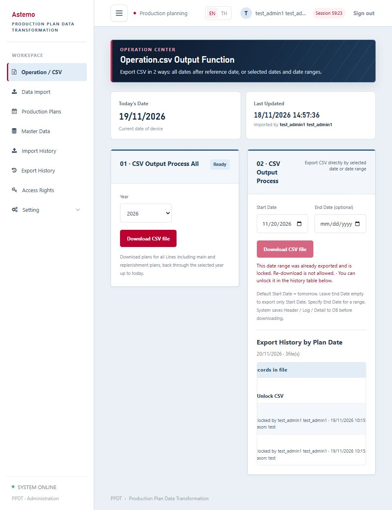
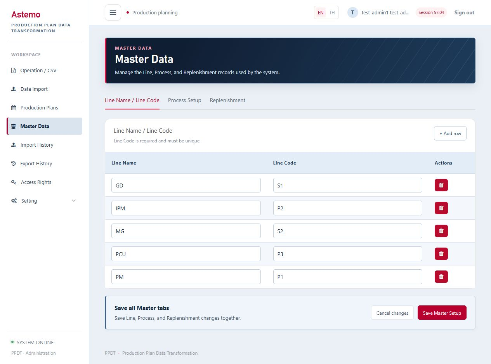
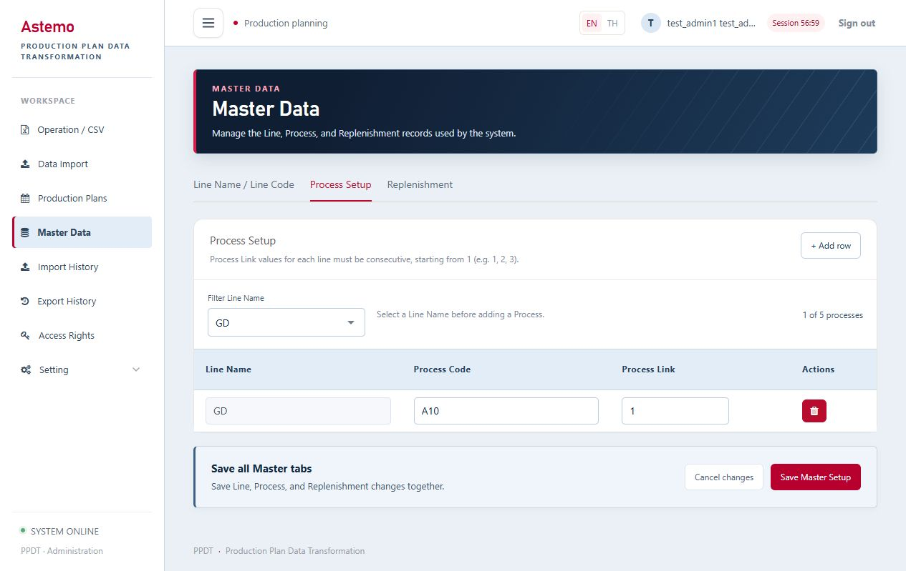
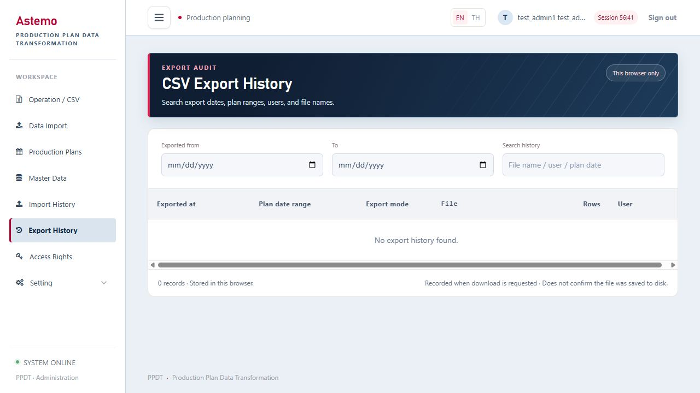
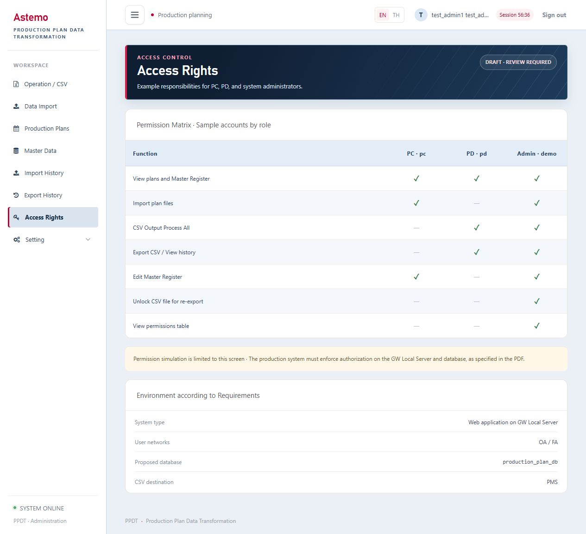
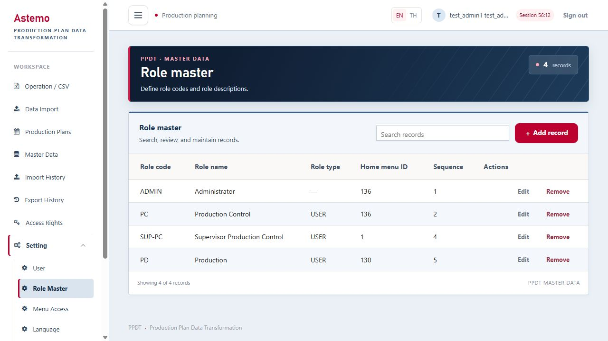
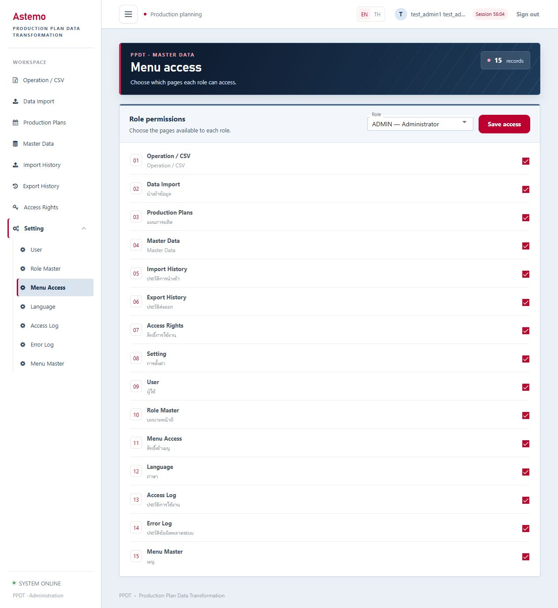
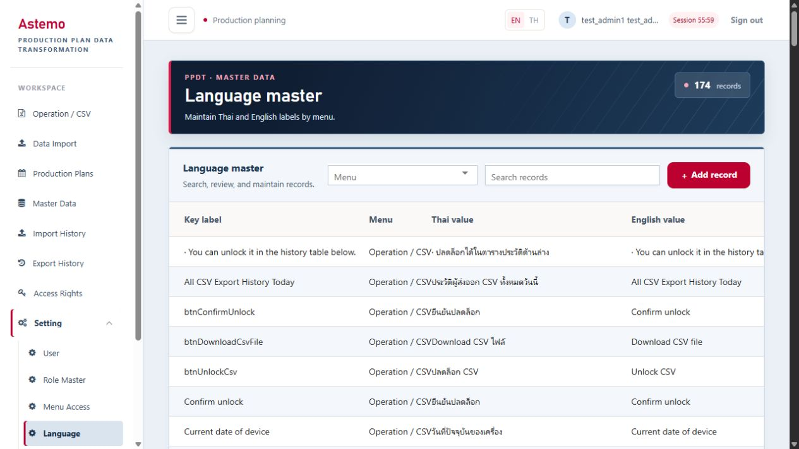
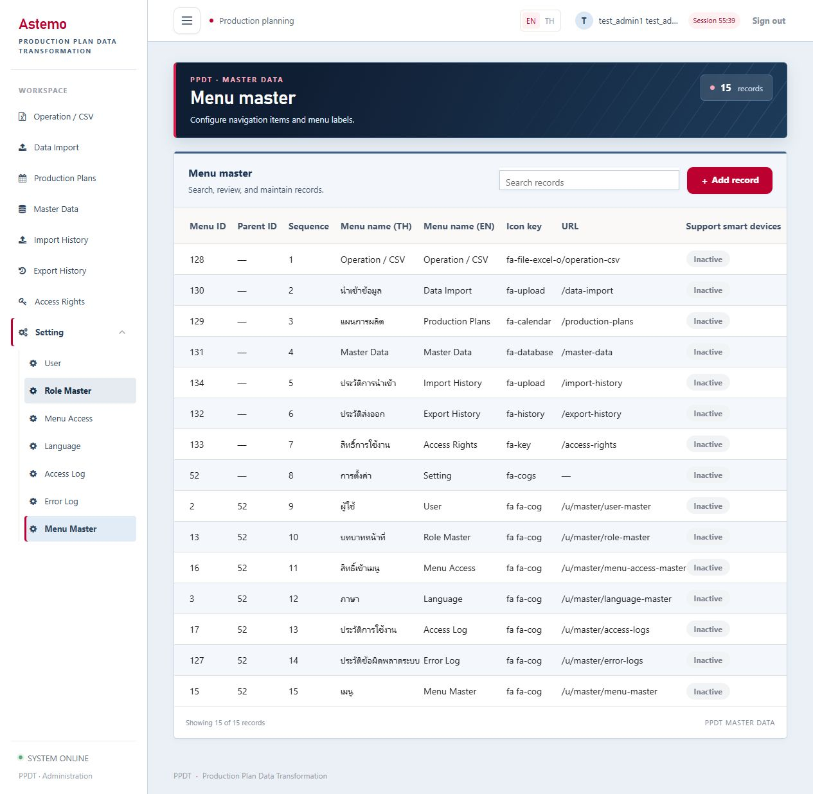

# คู่มือใช้งานระบบ PPDT

Production Plan Data Transformation · ฉบับสำรวจหน้าจอทั้งระบบ

ตรวจสอบวันที่ 19 พฤศจิกายน 2026 · บัญชี Administration · อ้างอิงชื่อปุ่มภาษาอังกฤษ

## ขอบเขตและสถานะคู่มือ

คู่มือนี้ครอบคลุมทุกเมนูที่บัญชีปัจจุบันเข้าถึงได้: Operation / CSV, Data Import, Production Plans, Master Data, Import History, Export History, Access Rights และ Setting ซึ่งมี User, Role Master, Menu Access, Language, Access Log, Error Log และ Menu Master

ตรวจสอบโดยเปิดอ่านหน้าจอ เปิดแท็บ และเปิดแบบฟอร์มผู้ใช้แล้วปิดโดยไม่บันทึก ยังไม่ได้ทดลองนำเข้าไฟล์ ส่งออก CSV ปลดล็อก บันทึกข้อมูลหลัก เปลี่ยนสิทธิ์ สร้างบัญชี หรือลบข้อมูล ขั้นตอนที่มีการบันทึกในคู่มืออธิบายจากปุ่มและคำแนะนำที่พบ ไม่ใช่ผลทดสอบสำเร็จ ระบบสำหรับบทบาท PC / PD อาจแสดงเมนูต่างจากบัญชีนี้

## สารบัญ

1. เริ่มต้นใช้งานและลำดับงาน
2. Data Import — นำเข้าแผนผลิต
3. Production Plans — ตรวจสอบแผนผลิต
4. Operation / CSV — ส่งออกไฟล์
5. Master Data — ข้อมูลหลัก
6. Import History — ประวัตินำเข้า
7. Export History — ประวัติส่งออกในเบราว์เซอร์
8. Access Rights — ตัวอย่างตารางหน้าที่
9. Setting / User — ผู้ใช้
10. Setting / Role Master — บทบาท
11. Setting / Menu Access — สิทธิ์เข้าเมนู
12. Setting / Language — ข้อความสองภาษา
13. Setting / Access Log — บันทึกการใช้งาน
14. Setting / Error Log — บันทึกข้อผิดพลาด
15. Setting / Menu Master — โครงสร้างเมนู
16. ปัญหาที่พบบ่อยและรายการตรวจรับ

## 1. เริ่มต้นใช้งานและลำดับงาน

เปิด https://ppdt.toptier-ari.com/operation-csv หากพบหน้าเข้าสู่ระบบ ให้กรอก Email และ Password ของบัญชี PPDT แล้วกด **Sign in**

แถบด้านซ้ายใช้เลือกหน้างาน ปุ่ม **Setting** ใช้เปิดหรือพับเมนูย่อย แถบด้านบนมี **EN / TH**, ชื่อผู้ใช้, เวลาคงเหลือของ Session และ **Sign out** เมื่อทำงานเสร็จให้กด Sign out

ลำดับงานที่แนะนำสำหรับผู้รับผิดชอบแต่ละส่วน:

| ขั้น | หน้า | สิ่งที่ต้องทำ |
|---|---|---|
| 1 | Master Data | ตรวจข้อมูล Line, Process และ Replenishment ให้พร้อม |
| 2 | Data Import | เลือกไฟล์ Excel และตรวจผลนำเข้า |
| 3 | Import History | ตรวจชื่อไฟล์ ผู้ส่ง และสถานะการนำเข้า |
| 4 | Production Plans | ตรวจวันผลิต Part number ปริมาณ และกระบวนการ |
| 5 | Operation / CSV | เลือกวิธีส่งออกและตรวจช่วงวันที่ |
| 6 | ประวัติใน Operation / CSV และ Export History | ตรวจรายการส่งออก พร้อมตรวจไฟล์ในเบราว์เซอร์หรือเครื่อง |

Data Import ระบุว่าเก็บข้อมูลลง staging เท่านั้น จึงไม่ควรถือว่าการนำเข้าสำเร็จหมายถึงข้อมูลผ่านทุกขั้นตอนและพร้อมใช้งานปลายทางแล้ว ความสัมพันธ์ระหว่าง staging กับข้อมูลที่ส่งออกต้องยืนยันกับผู้ดูแล

## 2. Data Import — นำเข้าแผนผลิต

ใช้สำหรับอัปโหลด Excel แผนผลิตเพื่อตรวจสอบและเก็บข้อมูล รองรับ **.xlsx / .xls ขนาดไม่เกิน 50 MB** ตามข้อความหน้าจอ

1. เลือก **Data Import**
2. หากต้องการไฟล์อ้างอิง กด **Download THPY Excel sample** และตรวจรูปแบบตัวอย่างก่อนเตรียมข้อมูล
3. กด **Choose file** แล้วเลือกไฟล์แผนผลิต
4. ตรวจชื่อไฟล์ที่เลือก ก่อนกด **Import** เมื่อปุ่มพร้อมใช้งาน
5. ตรวจส่วน **Latest import result** เพื่อดูสถานะ จำนวน staging rows จำนวน products ชื่อไฟล์ ขนาดไฟล์ หมายเลข Import เวลาปรับปรุง และผู้ปรับปรุง
6. ไปที่ **Import History** เพื่อตรวจรายการของครั้งนั้นอีกครั้ง

ปุ่ม **Download latest imported file** ใช้ดาวน์โหลดไฟล์ต้นฉบับที่นำเข้าล่าสุด ไม่ได้ระบุว่าเลือกดาวน์โหลดต้นฉบับทุกครั้งในอดีตได้

หากผลเป็น FAILED ให้ตรวจไฟล์กับตัวอย่างและประสานผู้ดูแลพร้อมชื่อไฟล์และเวลาที่นำเข้า ไม่ควรถือว่าข้อมูลเข้าครบจากการเลือกไฟล์เพียงอย่างเดียว ข้อกำหนดชีต คอลัมน์ และการจัดการรายการซ้ำยังไม่ได้ตรวจจากไฟล์ตัวอย่าง

## 3. Production Plans — ตรวจสอบแผนผลิต

1. เลือก **Production Plans**
2. กำหนด **Start date / End date** ตามช่วงที่ต้องการตรวจสอบ
3. ใช้ **Production line** เลือกสายการผลิต หรือ **All production lines**
4. ใส่หมายเลขสินค้าที่ **Search part number** หากต้องการค้นหา
5. เลือก **Plan type**: All types, Main plan หรือ Replenishment
6. ตรวจข้อมูลในตาราง ใช้ปุ่มหัวคอลัมน์เพื่อเรียงลำดับ และ **Items per page / ปุ่มเปลี่ยนหน้า** เพื่อดูรายการเพิ่มเติม

| คอลัมน์ | ใช้ตรวจสอบ |
|---|---|
| Part number | หมายเลขสินค้า |
| production date | วันผลิต |
| quantity | จำนวนผลิต |
| Line | รหัสสายการผลิต |
| process no | รหัสกระบวนการ |
| replace | รหัสที่แสดงในข้อมูลส่งออก ต้องยืนยันความหมายและการจับคู่กับ Replenishment กับเจ้าของระบบ |

**Import data** เป็นทางเข้าการนำเข้าข้อมูล ส่วน **Choose CSV export range** เปิดหน้า Operation / CSV พร้อม Start Date และ End Date จากช่วงที่เลือก ตรวจสอบการส่งต่อวันที่นี้แล้วจากหน้าจอจริง

ข้อความของส่วนส่งออกระบุว่า **ส่งออกทุก Line และทุกประเภทแผน** จึงไม่ควรเข้าใจว่าตัวกรอง Production line, Part number และ Plan type จะจำกัดขอบเขตไฟล์ CSV ด้วย ให้ตรวจช่วงวันที่ที่หน้า Operation / CSV ก่อนดาวน์โหลดเสมอ

หน้าจอมีข้อความ Sample batch กำกับอยู่ จึงควรยืนยันกับผู้ดูแลว่าข้อมูลตารางที่เห็นมาจากชุดใดก่อนใช้ตรวจรับข้อมูลจริง

## 4. Operation / CSV — ส่งออกไฟล์

ตรวจ **Today's Date** ซึ่งหน้าจอระบุว่าอ้างอิงวันที่อุปกรณ์ และ **Last Updated / Imported by** ก่อนส่งออก

### 4.1 CSV Output Process All

1. เลือก **Year** ในส่วน **01 · CSV Output Process All**
2. ตรวจปีและความพร้อมของข้อมูล
3. กด **Download CSV file** ในส่วน 01

คำแนะนำประจำส่วนระบุว่าครอบคลุมทุก Line ทั้งแผนหลักและแผนเติม ตั้งแต่ปีที่เลือกจนถึงวันนี้ แต่คำอธิบายรวมกล่าวถึงวันที่อ้างอิง จึงต้องยืนยันเกณฑ์วันที่กับผู้ดูแลก่อนออกมาตรฐานปฏิบัติงาน

### 4.2 CSV Output Process สำหรับวันเดียวหรือช่วงวันที่

1. ในส่วน **02 · CSV Output Process** กำหนด **Start Date** ค่าเริ่มต้นตามข้อความหน้าจอคือวันพรุ่งนี้
2. เว้น **End Date (optional)** ว่างเพื่อส่งออกวันเดียว หรือระบุวันสิ้นสุดเพื่อส่งออกช่วงวันที่
3. ตรวจวันเริ่มต้นและสิ้นสุด พร้อมข้อความสถานะใต้ปุ่ม
4. เมื่อปุ่มพร้อมใช้งาน กด **Download CSV file** ในส่วน 02

ข้อความหน้าจอระบุว่าระบบบันทึก Header / Log / Detail ก่อนดาวน์โหลด หากไม่พบไฟล์ ให้ตรวจประวัติและรายการดาวน์โหลดก่อนสั่งซ้ำ

### 4.3 ช่วงวันที่ถูกล็อกและการปลดล็อก

ข้อความ **This date range was already exported and is locked. Re-download is not allowed.** หมายถึงเคยส่งออกและถูกล็อก ปุ่มดาวน์โหลดจะไม่พร้อมใช้งาน

ตาราง **Export History by Plan Date** แสดง Exported At, File / User และ Records in file รายการที่ปลดล็อกแล้วจะแสดงผู้ปลดล็อก เวลา และ Reason

สำหรับผู้มีหน้าที่ปลดล็อก:

1. ตรวจวันที่แผน ชื่อไฟล์ และรายการประวัติ
2. กด **Unlock CSV** ในรายการที่ต้องการ
3. กรอก **Unlock reason** ให้ระบุเหตุผลของการส่งออกใหม่
4. ตรวจรายการก่อนกด **Confirm unlock**
5. ตรวจสถานะจริงหลังบันทึก แล้วตรวจช่วงวันที่อีกครั้งก่อนส่งออกใหม่

ตรวจพบช่องและปุ่มเหล่านี้จริง แต่ยังไม่ได้ยืนยันปลดล็อกหรือทดสอบส่งออกใหม่ คู่มือแยกขั้นตอนนี้จากหน้าประวัติส่งออกในเบราว์เซอร์ซึ่งอธิบายในหัวข้อ 7

## 5. Master Data — ข้อมูลหลัก

มี 3 แท็บ ได้แก่ **Line Name / Line Code**, **Process Setup** และ **Replenishment**

### 5.1 Line Name / Line Code

1. เปิดแท็บ **Line Name / Line Code**
2. ตรวจหรือแก้ **Line Name / Line Code** ของแถวที่ต้องการ
3. หากต้องเพิ่มรายการ ใช้ **+ Add row** แล้วระบุข้อมูล
4. ตรวจว่า **Line Code ไม่ว่างและไม่ซ้ำกัน** ตามข้อกำหนดหน้าจอ

ปุ่ม **Remove** อยู่ที่แต่ละแถว ใช้กับรายการที่ตั้งใจนำออกเท่านั้น ผลต่อข้อมูลที่อ้างอิงต้องยืนยันกับผู้ดูแลก่อนใช้งานจริง

### 5.2 Process Setup

1. เปิดแท็บ **Process Setup**
2. เลือก **Filter Line Name** ให้ตรงกับสายการผลิต
3. ตรวจ Process Code และ Process Link ของ Line นั้น
4. หากต้องเพิ่ม ใช้ **+ Add row** หลังเลือก Line แล้ว
5. ตรวจ **Process Link ให้เรียงต่อเนื่องเริ่มจาก 1** เช่น 1, 2, 3 ภายในแต่ละ Line

Line Name ในแถว Process ที่ตรวจพบเป็นช่องแก้ไขไม่ได้ ใช้ตัวเลือก Filter Line Name เพื่อเลือก Line ก่อนทำงาน

### 5.3 Replenishment

ตารางมี **Replenishment ID / Replenishment Name / Replenishment Code** ใช้ + Add row เพื่อเตรียมรายการใหม่ และแก้ชื่อหรือรหัสในรายการที่แก้ไขได้

ข้อกำหนดจากหน้าจอ: ชื่อยาว **1–80 ตัวอักษรและไม่ซ้ำกัน**; **ID 1 แก้ไขหรือลบไม่ได้** ซึ่งรายการที่พบคือ No Refill และ Code 0

### 5.4 บันทึกทุกแท็บ

**Save Master Setup** บันทึก Line, Process และ Replenishment พร้อมกัน ตรวจการเปลี่ยนแปลงทั้ง 3 แท็บก่อนกด หากต้องการยกเลิกการแก้ไข ใช้ **Cancel changes** การบันทึกและยกเลิกยังไม่ได้ทดลองในครั้งนี้

## 6. Import History — ประวัตินำเข้า

*ภาพหน้านี้ไม่รวมในคู่มือสาธารณะ เนื่องจากมีข้อมูลบัญชีผู้ใช้หรือบันทึกการใช้งาน*

1. เลือก **Import History**
2. ระบุ **Imported from / To** เพื่อจำกัดช่วงวันที่นำเข้า
3. ใช้ **Search history** ค้นหาชื่อไฟล์หรือผู้นำเข้า
4. ตรวจ Imported at, File name, File size, Imported by และ Status
5. ใช้หัวคอลัมน์เพื่อเรียงข้อมูล และ Items per page / ปุ่มเปลี่ยนหน้าเพื่อดูรายการเพิ่มเติม

วันที่กรองคือวันที่นำเข้า ไม่ใช่วันผลิตในแผน พบสถานะ **SUCCESS** และ **FAILED** ในประวัติจริง หากต้องตามปัญหาให้บันทึกชื่อไฟล์ เวลานำเข้า ผู้ส่ง และสถานะของรายการนั้น

## 7. Export History — ประวัติส่งออกในเบราว์เซอร์

1. เลือก **Export History**
2. ระบุ **Exported from / To** เพื่อกรองวันที่สั่งส่งออก
3. ใช้ **Search history** ค้นหาชื่อไฟล์ ผู้ใช้ หรือวันที่แผน
4. ตรวจ Exported at, Plan date range, Export mode, File, Rows และ User

หน้านี้ระบุ **This browser only / Stored in this browser** และบันทึกเมื่อมีการร้องขอดาวน์โหลด **ไม่ได้ยืนยันว่าไฟล์ถูกบันทึกลงดิสก์แล้ว** ระหว่างสำรวจ หน้านี้ว่าง แม้หน้า Operation / CSV มีประวัติอยู่ จึงต้องแยกแหล่งประวัติทั้งสองให้ชัดเจน

หากเปลี่ยนเบราว์เซอร์หรือไม่พบรายการที่นี่ ไม่ควรสรุปทันทีว่าไม่มีการส่งออก ให้ตรวจประวัติตามวันที่แผนใน Operation / CSV และไฟล์ในเครื่องประกอบ

## 8. Access Rights — ตัวอย่างตารางหน้าที่

หน้านี้แสดงตัวอย่างแบ่งหน้าที่ พร้อมป้าย **DRAFT · REVIEW REQUIRED** และข้อความว่าเป็นการจำลองสิทธิ์เฉพาะหน้าจอ ตารางนี้จึงไม่ใช่หลักฐานยืนยันสิทธิ์ที่ระบบบังคับใช้จริง

| ฟังก์ชันตามตารางตัวอย่าง | PC | PD | Admin |
|---|---|---|---|
| ดูแผนและ Master Register | ✓ | ✓ | ✓ |
| นำเข้าไฟล์แผน | ✓ | — | ✓ |
| CSV Output Process All | — | ✓ | ✓ |
| ส่งออก CSV / ดูประวัติ | — | ✓ | ✓ |
| แก้ไข Master Register | ✓ | — | ✓ |
| ปลดล็อก CSV เพื่อส่งออกซ้ำ | — | — | ✓ |
| ดูตารางสิทธิ์ | — | — | ✓ |

ใช้หน้านี้อ่านแนวทางหน้าที่ สำหรับตรวจหรือกำหนดสิทธิ์หน้าเมนูให้ดู **Setting → Menu Access** โดยยังต้องยืนยันการบังคับสิทธิ์จริงกับผู้ดูแล ตารางตัวอย่างไม่ครอบคลุมบทบาท SUP-PC ที่พบใน Role Master

## 9. Setting / User — ผู้ใช้

*ภาพหน้านี้ไม่รวมในคู่มือสาธารณะ เนื่องจากมีข้อมูลบัญชีผู้ใช้หรือบันทึกการใช้งาน*

เปิด **Setting → User** ใช้ **Search records** ค้นหาบัญชี ตรวจ User code, Email, First name, Last name, Role และ Active มี **Edit / Remove** ประจำแถว และ **+ Add record** สำหรับเพิ่ม

ขั้นตอนเตรียมเพิ่มผู้ใช้จากแบบฟอร์มที่ตรวจสอบ:

1. กด **+ Add record**
2. ระบุ User code, Email, First name และ Last name
3. เลือก Role ตามหน้าที่ที่ได้รับอนุมัติ
4. กำหนด Password และสถานะ Active ตามกระบวนการจัดการบัญชีขององค์กร
5. ตรวจข้อมูลก่อนกด **Create** หรือใช้ **Cancel / Close** เพื่อออกโดยไม่สร้าง

การเปลี่ยนรหัสผ่านควรให้เจ้าของบัญชีหรือผู้ดูแลดำเนินการตามกระบวนการองค์กร ไม่ส่งรหัสผ่านในเอกสารหรือข้อความทั่วไป

การแก้ไขใช้ Edit ของบัญชีที่ค้นพบ แล้วตรวจข้อมูลในแบบฟอร์มก่อนบันทึก ยังไม่ได้ตรวจแบบฟอร์ม Edit หรือผลการสร้าง/แก้ไข/ลบ จึงไม่ระบุข้อกำหนดความซ้ำ นโยบายรหัสผ่าน หรือความสามารถกู้คืนบัญชีที่ลบ

## 10. Setting / Role Master — บทบาท

ใช้กำหนดบทบาท เปิด **Setting → Role Master** แล้วค้นหาด้วย **Search records** ตรวจข้อมูลดังนี้:

| ช่องในตาราง | จุดตรวจสอบ |
|---|---|
| Role code | รหัสบทบาท |
| Role name | ชื่อบทบาท |
| Role type | ประเภทบทบาท |
| Home menu ID | รหัสหน้าเริ่มต้น ต้องจับคู่กับ Menu Master |
| Sequence | ค่าลำดับ |

พบ ADMIN, PC, SUP-PC และ PD ในระบบขณะสำรวจ ใช้ **+ Add record** เพื่อเปิดแบบฟอร์มเพิ่ม หรือ **Edit** สำหรับรายการเดิม ตรวจฟอร์มจริงและข้อมูลก่อนบันทึก **Remove** ใช้นำรายการออก แต่เงื่อนไขกรณีมีผู้ใช้อ้างอิงยังไม่ได้ทดสอบ

การมีบทบาทอยู่ใน Role Master ไม่ได้ยืนยันว่าบทบาทนั้นเข้าหน้าใดได้ ต้องตรวจ Menu Access ประกอบ

## 11. Setting / Menu Access — สิทธิ์เข้าเมนู

1. เปิด **Setting → Menu Access**
2. เลือก **Role** ที่ต้องการตรวจสอบ
3. ตรวจช่องเลือกของแต่ละเมนูให้ตรงกับหน้าที่ที่อนุมัติ
4. เมื่อต้องแก้ไขจริง ให้ปรับเฉพาะเมนูที่ต้องการ ตรวจ Role และรายการทั้งหมดก่อนกด **Save access**
5. หลังบันทึก ให้ผู้ใช้บทบาทนั้นตรวจเมนูที่เข้าถึงได้ตามขั้นตอนตรวจรับของผู้ดูแล

หน้านี้พบเมนู 15 รายการ รวม Setting และเมนูย่อย ยังไม่ได้เปลี่ยนช่องเลือกหรือกด Save access และยังไม่ยืนยันว่าการเลือกเมนูหลักส่งผลต่อเมนูย่อยอัตโนมัติหรือไม่

## 12. Setting / Language — ข้อความสองภาษา

ใช้ดูแลข้อความไทยและอังกฤษรายเมนู แตกต่างจากปุ่ม EN / TH ซึ่งใช้เลือกภาษาที่แสดง

1. เปิด **Setting → Language**
2. ใช้ตัวเลือก **Menu** จำกัดเมนู และ **Search records** ค้นหาข้อความ
3. ตรวจ **Key label, Menu, Thai value และ English value**
4. ใช้ **Edit** เพื่อเปิดแก้ไขคำแปลของรายการ หรือ **+ Add record** เพื่อเปิดเพิ่ม
5. ตรวจ Key label และเมนูให้ตรงกันก่อนบันทึก แล้วตรวจข้อความในหน้าที่เกี่ยวข้อง

มี Remove ประจำแถว แต่ไม่ควรลบ Key ที่หน้าจอใช้อยู่โดยยังไม่ตรวจผลกระทบ กติกา Key ซ้ำและผลหลังบันทึกยังไม่ได้ทดสอบ

## 13. Setting / Access Log — บันทึกการใช้งาน

*ภาพหน้านี้ไม่รวมในคู่มือสาธารณะ เนื่องจากมีข้อมูลบัญชีผู้ใช้หรือบันทึกการใช้งาน*

เปิด **Setting → Access Log** เพื่อดูการเข้าสู่ระบบและการทำงานของผู้ดูแล หน้าจอระบุ **Latest 1,000 records**

1. ใช้ **Search records** ค้นหารายการที่เกี่ยวข้อง
2. ตรวจ **Date and time, Action, Method / route, IP address และ User ID**
3. ใช้หัวคอลัมน์เพื่อเรียงข้อมูล
4. เมื่อตรวจเหตุการณ์ ให้จับคู่เวลา Action และ User ID กับงานที่ต้องติดตาม

ตัวอย่าง Action ที่พบ ได้แก่ Login, LoginFailed, UpdateUser, SaveMasterData และ UpdateMenuAccess จำนวนรายการที่หน้าจอโหลดไม่ได้ยืนยันระยะเวลาเก็บประวัติทั้งหมดของระบบ

## 14. Setting / Error Log — บันทึกข้อผิดพลาด

*ภาพหน้านี้ไม่รวมในคู่มือสาธารณะ เนื่องจากมีข้อมูลบัญชีผู้ใช้หรือบันทึกการใช้งาน*

เปิด **Setting → Error Log** เพื่อดูข้อผิดพลาดฝั่งเซิร์ฟเวอร์ หน้าจอระบุ Latest 1,000 records และไม่แสดงรายละเอียด exception ที่อ่อนไหว

1. ใช้ **Search records** ค้นหาเหตุการณ์
2. ตรวจ **Date and time, Error code, Route, Message และ IP address**
3. แจ้งผู้ดูแลพร้อมเวลา Error code Route และอาการที่ผู้ใช้พบ

พบตัวอย่าง API_UNHANDLED พร้อมข้อความ An unhandled server error occurred. ข้อความนี้เป็นข้อมูลเริ่มต้นสำหรับติดตาม ไม่เพียงพอให้ระบุสาเหตุรากของปัญหา ต้องตรวจข้อมูลฝั่งเซิร์ฟเวอร์โดยผู้รับผิดชอบต่อ

## 15. Setting / Menu Master — โครงสร้างเมนู

ใช้ตั้งค่าโครงสร้างเมนูและชื่อที่แสดง เปิด **Setting → Menu Master** แล้วใช้ Search records ค้นหารายการ

| ช่องในตาราง | จุดตรวจสอบ |
|---|---|
| Menu ID | รหัสเมนู ใช้เชื่อมโยงกับข้อมูลอื่น |
| Parent ID | รหัสเมนูแม่ สำหรับจัดกลุ่มเมนูย่อย |
| Sequence | ค่าลำดับการแสดง |
| Menu name (TH) / (EN) | ชื่อสองภาษา |
| Icon key | ค่ารูปสัญลักษณ์ |
| URL | เส้นทางหน้าของเมนู |
| Support smart devices | สถานะตามชื่อคอลัมน์นี้ ไม่ใช่สถานะ Active ของผู้ใช้ |

ใช้ **+ Add record / Edit** เพื่อเปิดแบบฟอร์มตามงานที่ได้รับมอบหมาย ตรวจข้อมูลและความสัมพันธ์กับ Role Master / Menu Access ก่อนบันทึก มี **Remove** ประจำแถว แต่ยังไม่ได้ตรวจเงื่อนไขการลบและผลต่อเมนูย่อย

ค่า URL ของบางเมนูย่อยในตารางเป็นรูปแบบ /u/master/... ขณะที่ลิงก์นำทางที่เปิดจริงใช้เส้นทางสั้นกว่า คู่มือนี้ใช้เมนูที่เห็นบนหน้าจอเป็นทางเข้า ไม่สรุปว่าค่าในตารางผิดหรือควรแก้โดยยังไม่ตรวจกลไกระบบ

## 16. ปัญหาที่พบบ่อยและรายการตรวจรับ

| อาการ | แนวทางตรวจสอบ |
|---|---|
| ปุ่ม Import ไม่พร้อมใช้งาน | ตรวจว่าเลือกไฟล์แล้ว ชนิดและขนาดอยู่ในข้อกำหนด |
| นำเข้า FAILED | จดชื่อไฟล์และเวลาจาก Import History ตรวจรูปแบบกับไฟล์ตัวอย่าง |
| ไม่พบแผนผลิต | ตรวจวันที่ Line Part number และ Plan type รวมถึงชุดข้อมูลที่แสดง |
| ดาวน์โหลด CSV ไม่ได้และมีข้อความล็อก | ตรวจประวัติวันที่แผน และให้ผู้มีหน้าที่พิจารณาปลดล็อกพร้อมเหตุผล |
| Export History ว่าง แต่เคยส่งออก | หน้านี้เก็บเฉพาะเบราว์เซอร์ ตรวจประวัติใน Operation / CSV และไฟล์ในเครื่อง |
| ไม่พบเมนู | ให้ผู้ดูแลตรวจ Role ของผู้ใช้และ Menu Access |
| ข้อมูลหลักบันทึกไม่ได้ | ตรวจ Line Code ไม่ซ้ำ, Process Link ต่อเนื่องจาก 1 และชื่อ Replenishment ตามกติกา |
| กลับหน้าเข้าสู่ระบบ | เข้าสู่ระบบใหม่ ตรวจสถานะและประวัติก่อนทำงานต่อ |
| เกิดข้อผิดพลาดเซิร์ฟเวอร์ | ตรวจ Error Log โดยจับคู่เวลาและ Route กับอาการ |

ก่อนออกคู่มือเป็นฉบับมาตรฐาน ควรตรวจรับในสภาพแวดล้อมที่เจ้าของระบบอนุญาต:

- นำเข้าไฟล์ตัวอย่างหนึ่งชุด และยืนยันผลกรณีสำเร็จ/ผิดรูปแบบ รวมถึงรายการซ้ำ
- ยืนยันขั้นตอนจาก staging ไปยังข้อมูลแผนที่ใช้ส่งออก
- ตรวจเกณฑ์วันที่ของ Process All และความหมาย replace
- ตรวจชื่อไฟล์ คอลัมน์ encoding ปริมาณ และเนื้อหา CSV จริง
- ตรวจผลปลดล็อกและส่งออกซ้ำ
- ตรวจสิทธิ์จริงด้วยบัญชี PC / PD / SUP-PC และการบังคับสิทธิ์ฝั่งเซิร์ฟเวอร์
- ตรวจผลบันทึก ยกเลิก ลบ และข้อกำหนดของแบบฟอร์มใน Setting
- ตรวจพฤติกรรม Session, ภาษา และการแสดงผลบนอุปกรณ์เป้าหมาย

ภาพหน้าจอเป็นตัวอย่าง ณ วันที่สำรวจ ชื่อบัญชี เวลา จำนวนรายการ และสถานะอาจเปลี่ยนได้ คู่มือนี้ไม่ใช้ข้อมูลตัวอย่างเป็นค่าที่ผู้ใช้ต้องกรอกตาม
